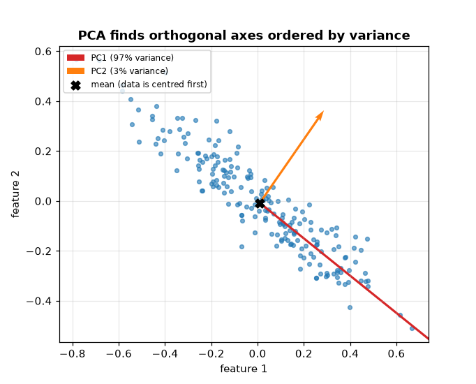
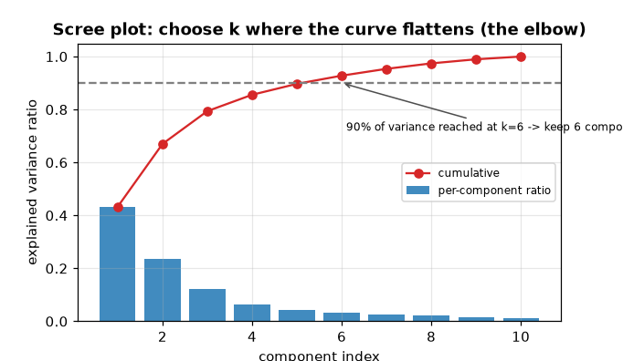
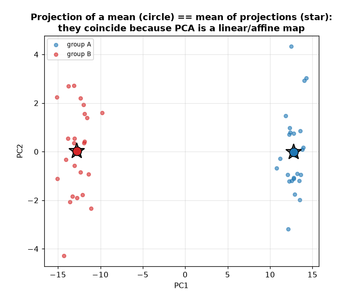

# 1. PCA — Principal Component Analysis

PCA answers one question: **in which directions does my data actually vary, and how much?**
It is the only visualization tool here that is a *deterministic linear map* — which makes it the
correct choice whenever you want to plot summary/mean vectors faithfully.

## 1.1 The geometric idea

Given `n` vectors in `d` dimensions (matrix `X`, shape `n × d`):

1. **Center** the data: `Xc = X - mean(X)` (each feature minus its column mean).
2. Find the unit direction `v1` along which the centered data has **maximum variance** → PC1.
3. Find `v2`, orthogonal to `v1`, with the next-largest variance → PC2. And so on.



The data above is a rotated elongated cloud: PC1 points along the long axis (≈ 85% of variance),
PC2 along the short one. Every other direction is a mix of these and carries less.

Mathematically, the principal directions are the **eigenvectors of the covariance matrix**
`C = Xcᵀ Xc / (n−1)` (equivalently the right singular vectors `V` of `Xc = U S Vᵀ`).
The **scores** (2-D picture) are the projections `P = Xc V_k`.

## 1.2 Explained variance ratio — how much truth survives the flattening

Each component owns a share of the total variance:

`explained_variance_ratio_i = λ_i / Σ λ_j`

Two rules of thumb:

- Look at the **scree plot** and keep the elbow (where the curve flattens).
- Always print the ratio on the axis labels (`PC1 (34.2%)`); a 2-D plot of data whose first two
  PCs explain 15% is a *distortion*, not a summary.



**High-dimensional embeddings caveat:** neural-net embeddings often have variance spread over
many dims (the top-2 PCs of 512-d vectors may explain only 20–40%). Then PCA is still a valid
*projection of your chosen summary vectors*, but "two clusters look merged" in the plot is not
proof they are merged in 512-D. Confirm with cosine/silhouette (docs 3–4).

## 1.3 Why projecting a mean is EXACT (linearity)

PCA's projection is an **affine** map:

`f(x) = Wᵀ (x − μ)`

Affine maps commute with averaging:

`f( (1/n) Σ xᵢ ) = Wᵀ( (1/n)Σxᵢ − μ ) = (1/n) Σ Wᵀ(xᵢ − μ) = (1/n) Σ f(xᵢ)`

So if your summary vector is a **mean of embedded samples** (e.g. `V_file = mean of 30-s chunk
embeddings`, the mean-pooling used in PPG/GPT-style embedding notebooks), its PCA position is
guaranteed to be the centroid of its members' positions. You can draw it, label it, trust it.



The circle (project the mean first) sits exactly under the star (project everything, then average).

**When it breaks:** the mean must be of the *same vectors* that were embedded and pooled with the
*same weights*. Non-linear pooling (attention, median), or a mean over vectors from a different
normalisation, no longer satisfies this. And remember the flip side: PCA being linear is exactly
why t-SNE (doc 2) **cannot** offer the same guarantee.

## 1.4 Practical pitfalls

| Pitfall | Fix |
|---|---|
| PCA dominated by one nuisance factor (subject identity, sensor gain, vector norm) | L2-normalise first, or center per-group; compare both |
| Axes swapped run-to-run / sign flips | signs are arbitrary; flip for display, never interpret ± |
| Fitting PCA separately on two groups → incomparable plots | fit ONE PCA on the pooled data, transform both groups with it |
| Fitting PCA including your "summary" rows twice (means + members) | fit on members only; means are exact anyway (1.3) |
| Reading distances in 2-D as if they were 512-D distances | quote explained variance; confirm with original-space metrics |

## 1.5 Minimal code

```python
from sklearn.decomposition import PCA
pc = PCA(n_components=2).fit(W)          # W: (n, 512) pool of ALL vectors
P = pc.transform(W)
V_file = W.groupby(keys).mean()          # mean-pooled vectors
F = pc.transform(V_file)                 # EXACT centroid positions in this plot
print(pc.explained_variance_ratio_)      # put these in the axis labels
```

**In this repo** (`premeal_postmeal_ppg_embedding_vis_meal_related.ipynb`, section 1):

```python
pc = PCA(n_components=2).fit(W)   # fit on every 30-s chunk embedding
P  = pc.transform(W)              # dots = chunks
mu = P[ix].mean(axis=0)           # star = V_file — exact, by 1.3
```

➡ Continue to [02_tsne.md](02_tsne.md): what changes when the map is *not* a projection.