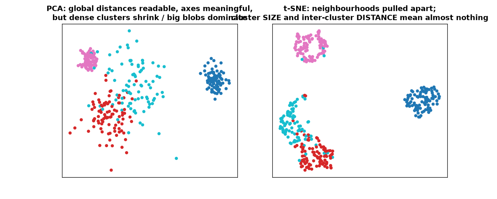
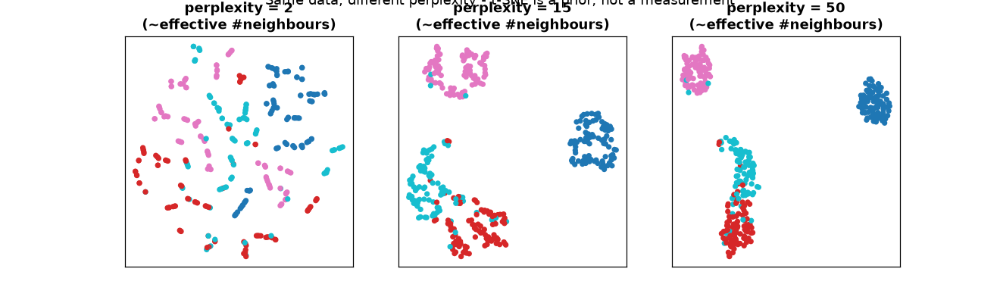
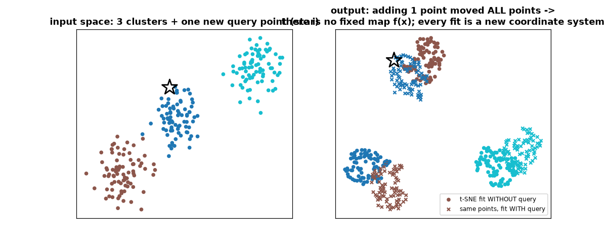

# 2. t-SNE — t-distributed Stochastic Neighbor Embedding

t-SNE is not a projection — it is an **optimised layout**. It trades global geometry for crisp
local neighbourhoods. Almost all misuse of t-SNE comes from forgetting that difference.

## 2.1 How it works (in three sentences)

1. In high-D, turn distances into **neighbourhood probabilities** `p(j|i)` — a Gaussian per point
   whose width σᵢ is tuned so the distribution over neighbours has a fixed entropy = **perplexity**
   (≈ the effective number of neighbours, typically 5–50).
2. In 2-D, define similar probabilities `q(j|i)` with a heavy-tailed Student-t kernel (the heavy
   tail is what prevents crowding — the "pearly-builder effect").
3. **Optimise the 2-D coordinates `y₁…yₙ` to minimise KL(P‖Q)** by gradient descent.

## 2.2 What t-SNE is good at — and what it lies about



| Trust | Don't trust |
|---|---|
| Which points are neighbours | Distances **between** clusters ("cluster A is closer to B than C" — meaningless) |
| That a group of points is locally tight | Cluster **size** (dense subpopulations look bigger; loose ones may just be noisy) |
| Outlier points sitting alone | Axis values, scales, and the exact rotation/mirror of the plot |

**Perplexity is a prior, not a measurement.** Different perplexities can merge or split the same
structure; if a cluster appears only at one perplexity, it is partly an artefact of that choice.



Practical defaults: `perplexity ≈ n/4` capped at 30–50 for small sets, `init="pca"`,
`learning_rate="auto"`, `random_state` fixed — and **always re-run with another seed** before
believing a pattern.

## 2.3 The core limitation: there is no out-of-sample map

In PCA you learn a function: `f(x) = Wᵀ(x − μ)`. Apply it to anything, anytime.

In t-SNE the *outputs themselves are the parameters*: the optimiser tunes each `yᵢ` directly to
reproduce the `p(j|i)` neighbourhood graph of **this exact dataset**. There is no `f`, no formula,
nothing to apply to a new vector. Worse, adding one point changes every `p(j|i)` and the optimiser
re-lays-out **everything**:



The x-marks are the same 240 points refit with a single extra query point (star): the entire cloud
moved and rearranged. Coordinates from two fits — or even two seeds of the same fit — are not
comparable.

**Consequence for plots like embedding dashboards:** if a figure shows "all samples as dots,
your summary vectors as stars", the stars may be drawn on a **PCA** panel (exact, doc 1) but must
**not** be drawn on a **t-SNE** panel — a mean vector was never part of the fit and has no honest
coordinates there. Honest alternatives on a t-SNE panel:

- colour/shape **only** points that were part of the fit;
- show trajectories/segments between fitted points (all coordinates real);
- if you truly need summaries, refit t-SNE **including** them and label the panel
  "layout changes when summaries are included" — never overlay two fits.
- If you need a real out-of-sample map: **UMAP** offers `.transform()` (an approximation, still
  stochastic), or fit a small regression (kNN average) from high-D vectors to 2-D as a heuristic.

## 2.4 Minimal code + the repo line

```python
from sklearn.manifold import TSNE
XY = TSNE(n_components=2, perplexity=24, init="pca",
          learning_rate="auto", random_state=0).fit_transform(W)   # W: (n, 512)
```

In the notebook (section 3) the pool `W` contains *only* the chunk embeddings, and the mean-pooled
stars are drawn on the PCA panel only — this doc explains why that asymmetry is deliberate.

## 2.5 Failure modes checklist

- **Single small class** (n < ~5× perplexity): clusters of 2–5 points are noise, not clusters.
- **Continuous gradients** rendered as islands: t-SNE loves discrete gaps; trajectories get torn.
- **Batch effects dominate**: nearest neighbours are "same recording", not "same class" —
  verify with a kNN-label test before interpreting colours.

➡ Continue to [03_cosine_vs_l2.md](03_cosine_vs_l2.md): measuring similarity where it counts —
in the original 512-D space, not in the layout.