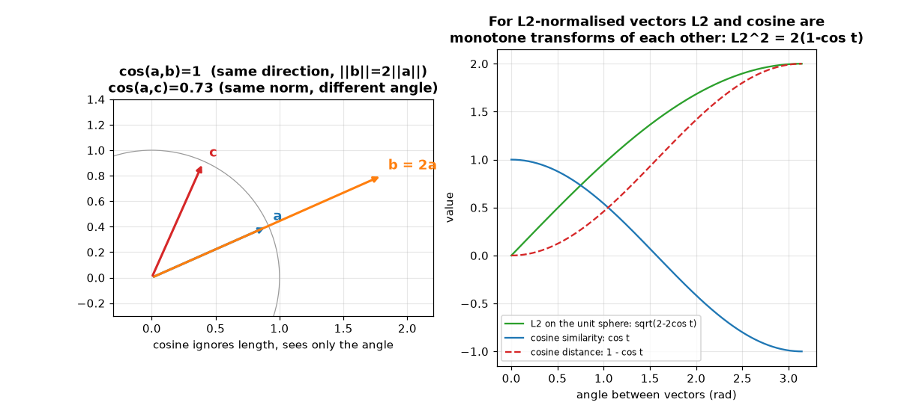
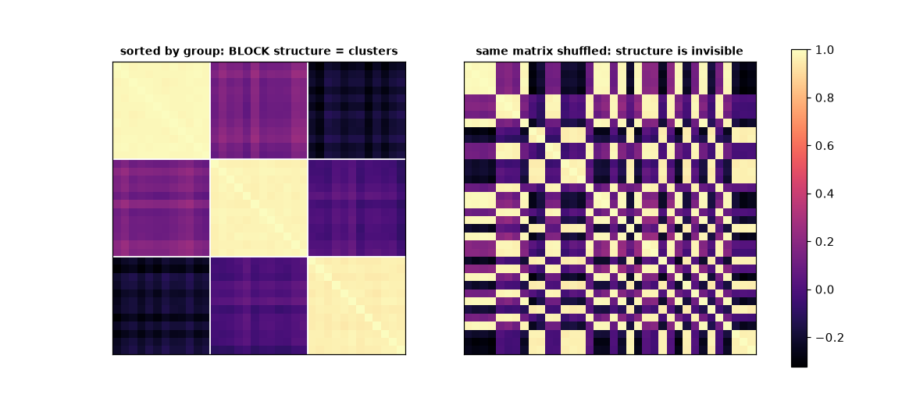

# 3. Cosine Similarity vs L2 Distance — and How to Read a Similarity Heatmap

Every cluster claim ("pre-meal embeddings are more similar to each other than to post-meal ones")
is a claim about **a distance measured in the original space**. Which one you pick matters.

## 3.1 Definitions

For vectors `a, b ∈ ℝᵈ`:

```
cosine similarity   cos(a,b) = (a·b) / (‖a‖ ‖b‖)      ∈ [-1, 1]   (1 = same direction)
cosine distance     1 - cos(a,b)                                  (0 = same direction)
L2 (Euclidean)      ‖a - b‖ = sqrt( Σ (aᵢ-bᵢ)² )                  (0 = identical)
L1 (Manhattan)      Σ |aᵢ-bᵢ|        (robust-ish, rare for embeddings)
```

Expanding L2 reveals the whole story:

```
‖a - b‖² = ‖a‖² + ‖b‖² - 2‖a‖‖b‖·cos(a,b)
```

**L2 mixes two things: angle AND magnitudes. Cosine keeps only the angle.**



- `b = 2a`: cosine 1.0 (identical direction) but L2 = ‖a‖. Two embeddings that differ only in
  *overall activation strength* (e.g. a slightly hotter detector, more motion energy) are
  "far apart" under L2 and "identical" under cosine.
- On the **unit sphere** (all vectors L2-normalised) the norms collapse to 1 and
  `‖a-b‖² = 2(1 - cos(a,b))` — cosine and L2 become monotone transforms of each other,
  and every algorithm's answer agrees. This is why many embedding papers normalise first:
  the metric debate disappears.

## 3.2 Which one to use for learned embeddings?

| Property of your vectors | Choose |
|---|---|
| Norm is meaningful (encodes confidence/intensity you care about) | L2 |
| Norm is nuisance (varies with recording quality, window length, model temperature) | cosine |
| Vectors are L2-normalised (e.g. CLIP-style, many SSL encoders) | either — identical ranking |
| kNN-style probes (nearest-neighbour classification of embeddings) | cosine is the common default |

Sanity rule: **report which one you used** — "mean cosine 0.74" and "mean L2 12.4" are not
comparable across papers/notebooks.

## 3.3 Similarity heatmaps

Compute the pairwise similarity matrix `M = X̂ X̂ᵀ` (rows of `X̂` L2-normalised → `M` is the cosine
matrix), then `imshow`. Rows/cols **sorted by group** so any cluster structure shows up as
**bright blocks along the diagonal**.



How to read it honestly:

- **Block brighter than off-diagonal** → the groups are genuinely more internally similar.
- Compare block *contrast*, not absolute values: with embeddings everything correlates (bottom
  panel: same matrix shuffled — the groups hide completely; that is why sorting matters).
- Watch the colour scale: `imshow` autoscales, so a contrast of 0.73 vs 0.71 can look like
  continents. Fix `vmin/vmax` or annotate numbers (as the repo notebook does).
- A **checkerboard inside a block** = subgroups (e.g. one subject, two wrist positions).
- Heatmaps are `n×n`: fine for tens of vectors, use clustering of `M` (e.g. `scipy` linkage) to
  choose a good row order for hundreds.

## 3.4 Minimal code

```python
Xn = X / np.linalg.norm(X, axis=1, keepdims=True)
M  = Xn @ Xn.T                                   # cosine matrix, (n, n)
plt.imshow(M, vmin=0.5, cmap="magma")            # fix the scale!

# within vs between group numbers
same = labels[:, None] == labels[None, :]
np.fill_diagonal(M, np.nan)
within, between = np.nanmean(M[same]), np.nanmean(M[~same])
```

**In this repo** (notebook sections 4 & 6): the 11 mean-pooled file vectors are sorted
pre-then-post and their cosine matrix drawn with white group borders; `within=0.744` vs
`between=0.747` — blocks indistinguishable from off-diagonal → *no* cluster structure, a
conclusion the heatmap makes visually obvious.

## 3.5 Centroids

The **centroid** of a group is the mean of its (usually L2-normalised) vectors, re-normalised:
`c = normalize(mean(xᵢ))`. Distance to a group centroid is the cheapest "class prototype" score —
and the basis of the next topic, since silhouette is built entirely from these same pairwise
distances.

➡ Continue to [04_silhouette_and_separation.md](04_silhouette_and_separation.md): turning
"the blocks look similar" into a defensible number.