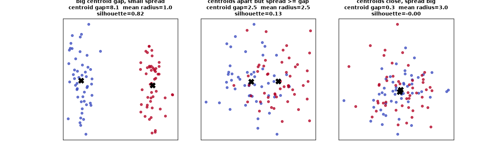
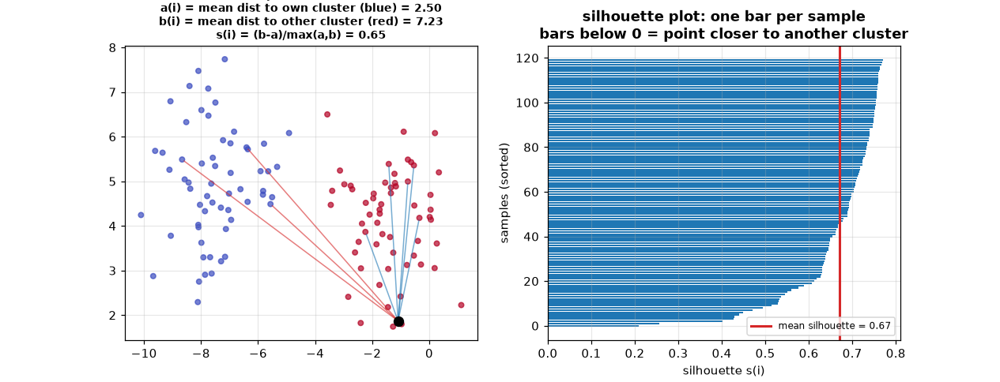

# 4. Silhouette Score, Centroids and Within/Between-Group Separation

Plots suggest; numbers decide. This doc covers the standard ways to answer:
**"are these two groups actually separated in the embedding space?"**

## 4.1 The within vs between principle

Almost every cluster-quality measure compares two quantities:

- **cohesion** — how close points are to their *own* group (within-group distances)
- **separation** — how far groups are from *each other* (between-group distances)

A real cluster: `separation > cohesion`. The centroid is the natural summary: the mean vector of
a group (re-normalised to unit length if you work with cosine). But centroid distance *alone* is
misleading — two distant centroids mean nothing if each group's spread swallows the gap:



Always report the centroid gap **relative to the within-group radius**
(mean distance of members to their own centroid) — the panels above show why:
same-looking scatter, wildly different structure.

## 4.2 Silhouette score — the per-sample version of the same idea

For each sample `i` (with `D` = the distance you chose, e.g. `1 - cosine`):

```
a(i) = mean D(i, j)  over j in the same group as i        (cohesion)
b(i) = min over other groups of  mean D(i, j)             (separation vs nearest group)

s(i) = ( b(i) - a(i) ) / max( a(i), b(i) )                ∈ [-1, 1]
```

- `s(i) → +1` : `i` sits well inside its group, far from the next one
- `s(i) ≈ 0`  : `i` is on the boundary between groups
- `s(i) < 0`  : `i` is closer to another group — likely mislabelled or the groups are one blob

The **silhouette score** is `mean s(i)`. Rough reading: `>0.5` well-separated, `0.25–0.5` weak
structure, `≈0` no structure, `<0` the labelling fights the geometry.



The silhouette *plot* (right panel) is more informative than the mean: overlapping bar
distributions below zero show exactly how many samples are misplaced.

## 4.3 Pitfalls (more important than the formula)

1. **Silhouette needs a distance.** Silhouettes on raw 512-d norms and on cosine are different
   numbers — state which. (sklearn's default is Euclidean; pass `metric="cosine"` for embeddings.)
2. **Tiny or imbalanced groups destroy it.** With 2 vs 9 samples the mean is dominated by the
   small group's luck; with 1 sample you get `silhouette_score == 0` (or a warning). Never
   compare silhouette across datasets with different `n` — compare against a
   **label-permutation null**: shuffle the labels 100×, keep the 95th percentile of the null
   scores; your real score must beat it.
3. **It is designed for found clusters, not for given labels** — using ground-truth labels is
   legitimate but then a low score means "labels don't match geometry", which can be true even
   when a *supervised* classifier separates the groups easily (silhouette measures
   density-shaped structure, a classifier uses discriminative directions).
4. **Pseudo-replication**: if one recording contributes 18 chunks and another 1, chunks are not
   independent observations — compute the score per-recording on mean-pooled vectors too, and
   report both (that is exactly what the repo notebook does).
5. High dimension: distances concentrate (all cosines ≈ 0.7); small gaps are normal, so demand
   a *consistent* within-vs-between gap, not a nonzero one.

## 4.4 Complementary numbers worth reporting next to it

| Measure | Formula | Catches |
|---|---|---|
| centroid gap / mean radius | `‖c₁-c₂‖ / mean_i‖xᵢ-c_{g(i)}‖` | global shift vs overlap (≈ effect size) |
| within − between similarity gap | `mean cos_within - mean cos_between` | the heatmap contrast, as one number |
| kNN label purity | fraction of points whose k nearest share the label | local, classifier-like separability |
| permutation null | 95th pct of silhouette over shuffled labels | whether *any* of the above beats chance |

## 4.5 Minimal code

```python
from sklearn.metrics import silhouette_score, silhouette_samples
s = silhouette_score(X, labels, metric="cosine")     # or "euclidean"
per_sample = silhouette_samples(X, labels, metric="cosine")

# honest null: does the score beat shuffled labels?
rng = np.random.default_rng(0)
null = [silhouette_score(X, rng.permutation(labels), metric="cosine") for _ in range(99)]
threshold = np.quantile(null, 0.95)
print(f"silhouette={s:.3f}  permutation 95th pct={threshold:.3f}  beats null: {s > threshold}")
```

**In this repo** (notebook section 6): silhouette is reported twice — over the 96 chunk embeddings
and over the 11 mean-pooled file vectors — plus within/between mean cosine and the centroid norm
gap. All four agree the two folders are *not* separated — a complete, honest negative result.

---

## Full-circle summary

```
PCA            → honest global view; means/summaries can be plotted exactly (affine map)
t-SNE          → local-neighbourhood view; fixed point set; never place new vectors on it
cosine vs L2   → choose by what the norm means; normalise and the choice vanishes
heatmap        → same matrix, visually: blocks = clusters (sort rows, fix the colour scale)
silhouette     → per-sample cohesion-vs-separation; interpret only vs a permutation null
```

Back to [README](README.md).