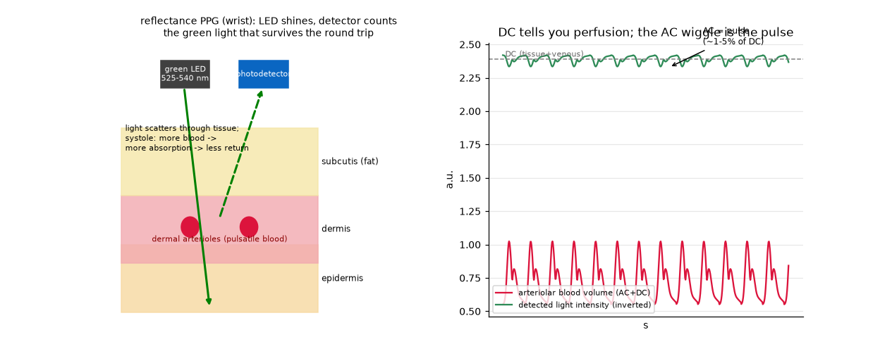
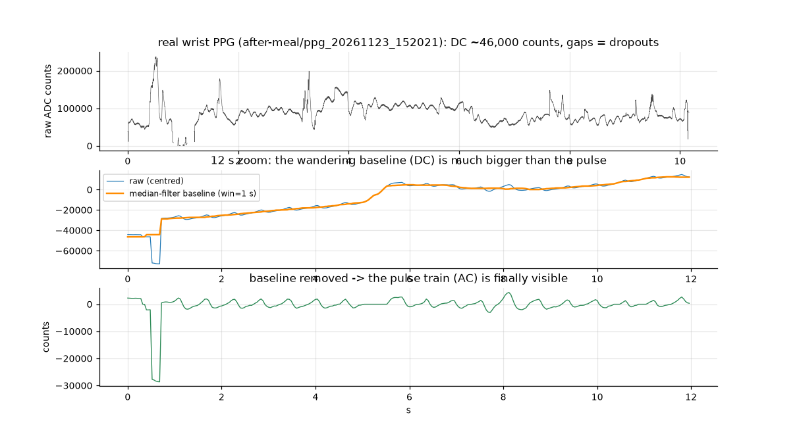

# 01 · What a PPG Signal Is: Light, Blood, AC/DC

**Goal:** understand physically what the number in `ppg_green` is, so every later tutorial
("baseline drift", "pulse amplitude") refers to something real.

## 1.1 The principle: you are measurable because blood absorbs light

An LED shines into skin. Light scatters through epidermis → dermis → subcutis, and a fraction
returns to the photodetector. Anything in that path absorbs light in proportion to its
concentration and path length (**modified Beer–Lambert law**):

`I = I₀ · exp(−Σ εᵢ cᵢ L · DP)`   (ε extinction coeff., c concentration, L path, DP path-length
increase from scattering)

Arterioles in the dermis fill with each systole → **blood volume changes ~1-5% each heartbeat** →
absorption changes → detected intensity changes in anti-phase with blood volume. That tiny optical
wiggle *is* the pulse wave. Everything else (skin, fat, venous blood) is roughly constant.



- **Transmission mode** (fingertip, pulse-oximeter clip): LED and detector on opposite sides.
- **Reflectance mode** (smartwatches, your data): both on the same side; only scattered photons
  return; weaker, more motion-sensitive — but wearable.
- **Wavelengths:** green (≈525-540 nm) is absorbed strongly by blood within the shallow dermal
  plexus → best wrist SNR, and mostly blind to motion-induced DC shifts deeper down. Red/IR
  penetrate further and are chosen for **SpO₂** (tut 14). Your file has one channel: `ppg_green`.

## 1.2 AC and DC: the pedestal problem

The raw signal is `x(t) = DC(t) + AC(t) + noise`, where:

| Component | Size (your data) | Carries |
|---|---|---|
| **DC** (baseline) | ~46,000 ADC counts, drifts by hundreds | tissue thickness, venous blood, sensor pressure, ambient leak |
| **AC** (pulse) | a few hundred counts | the arterial pulse — the information |
| noise/artifact | variable | motion, dropouts, quantisation |



Consequences you'll meet in every tutorial:

1. Never eyeball raw traces at full scale — always detrend first (tut 05).
2. **Amplitude is not calibrated**: counts depend on strap tightness and skin. Absolute pulse
   amplitude comparisons *across files or people* are meaningless; relative changes within a
   well-controlled window can be meaningful (this caveat matters for tut 18's meal claims).
3. DC itself is not useless — slow DC changes track perfusion/pressure artifacts, and your
   `status_code` wear flags are basically DC-based.

## 1.3 What actually moves the AC amplitude

- **Perfusion & vasomotor tone** (warmth, stress, post-meal vasodilation — tut 18)
- **Sensor pressure**: pressing the watch harder displaces blood → amplitude jumps (classic
  false "event" in free-living data)
- **Depth/fit/skin**: between-person differences of 10-100× — the reason ML pipelines
  z-score per window (tut 05) and per subject (tut 16)

## 1.4 Minimal code (from `ppg_synth.py`)

```python
import ppg_synth as ps
rec = ps.load_recordings()[0]          # your CSVs -> Rec(fs≈25Hz, x, bad)
base = ps.baseline_median(rec.x, rec.fs)   # DC estimate
ac   = rec.x - base                        # pulse train
```

## Pitfalls

| Pitfall | Reality |
|---|---|
| "PPG measures heart rate" | It measures **blood volume**; HR is an inference from its timing (tut 07) |
| "Green PPG = pulse oximetry" | SpO₂ needs red+IR with calibration (tut 14) |
| "Larger amplitude = stronger pulse" | Amplitude is dominated by sensor contact (1.3) |
| Zero/flat segments are "low pulse" | In your data `ppg_green ≤ 0` = **dropout**, mark invalid (tut 03/06) |

**When to think about this:** any time you compare amplitudes, or explain why a watch fails on
tattoos/dark skin/cold wrists (less return signal → AC buried in noise — a real, documented
equity issue in PPG sensing).

➡ Next: [02_pulse_wave_anatomy.md](02_pulse_wave_anatomy.md) — what one AC cycle looks like.