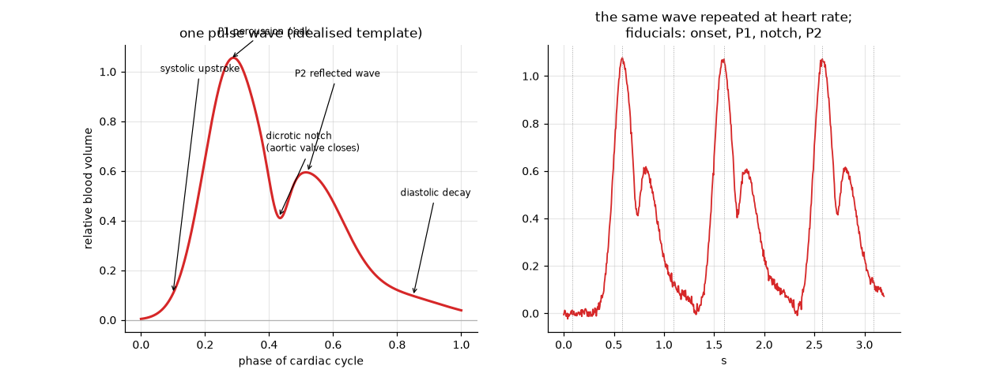
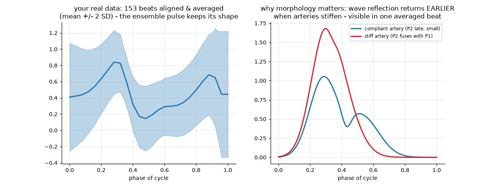

# 02 · Anatomy of One Pulse Wave

**Goal:** read a single beat like a clinician reads a pressure trace — each wiggle has a cause.

## 2.1 The fiducial points



One cardiac cycle of the PPG (idealised template, `ppg_synth._cycle`):

| Feature | Physiology | Timing (rest) |
|---|---|---|
| **onset (foot)** | isovolumetric ejection opens aortic valve; arterial pressure starts rising | diastole end |
| **systolic upstroke** | rapid ejection; slope ∝ stroke volume & arterial compliance | ~0.1-0.2 s |
| **P1 percussion peak** | forward pressure wave arrives at the wrist | early systole |
| **dicrotic notch** | **aortic valve closes**; small backflow | end systole |
| **P2 reflected wave** | wave reflected from bifurcations/arterioles returns | mid-late systole/diastole |
| **diastolic decay** | runoff through the periphery | rest of cycle |

At the **wrist** the reflected wave is late and large (peripheral measurement site); at the finger
P1/P2 are sharper; on the earlobe P2 nearly merges with P1. Site is a *design decision*, not a
detail — and wrist PPG is noisier partly for this reason.

## 2.2 Why morphology is information, not noise



The reflected wave returns **faster when arteries are stiffer** (higher pulse-wave velocity,
tut 13). Stiffness (age, hypertension, post-meal, cold) therefore *shifts P2 earlier and bigger*
until it merges with P1 — visible in one averaged beat, computable with two indices:

```
reflection index  RI   = (P2 - notch) / (P1 - notch)
P1→P2 delay              = t_P2 - t_P1   (in ms or % of cycle)
```

(defined in `ps.pwa()`, used in tut 12.)

## 2.3 Building the ensemble pulse from YOUR data

Individual wrist beats are noisy; the **ensemble average** is not:

```python
m, peaks = ps.beat_matrix(x, fs, nsamp=200)   # each beat resampled to 200 pts
template = m.mean(0)                          # noise shrinks ~1/sqrt(n)
```

The figure's left panel shows your 752 beats aligned on the systolic peak: mean ± 2 SD keeps a
clean, repeatable shape with a visible notch → your sensor/skin/strap combination is capable of
morphology analysis (not every dataset is — see tut 06).

## 2.4 Pitfalls

| Pitfall | Reality |
|---|---|
| Aligning beats on the **peak** for morphology studies | Peaks jitter with respiration; the **foot/onset** is the physiologically consistent fiducial (tangent method, tut 12) |
| Measuring P1/P2 on single beats at 25 Hz | 1 sample = 40 ms ≈ nothing at the notch; average first, or interpolate (tut 08) |
| Comparing morphology across files/subjects | Amplitude and timing scale with perfusion/fit; normalise per subject (tut 12/16) |
| Notch "missing" = artifact | At the wrist with slow HR it can genuinely fuse; check HR-matched template first |

**When to use:** pulse-wave analysis (tut 12), vascular-age research, and as QC — a file whose
ensemble beat has no systolic shoulder is usually a bad fit, not physiology (tut 06).

➡ Next: [03_reading_real_ppg_data.md](03_reading_real_ppg_data.md).