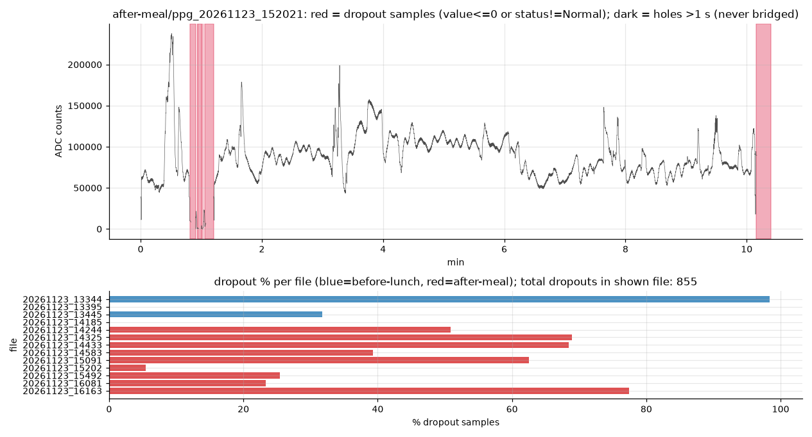
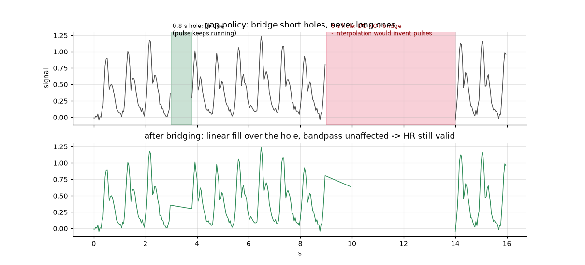

# 03 · Reading Real PPG Data: Your Files, Sampling, Dropouts

**Goal:** open one of your CSVs and know exactly what every column, gap and spike is before any
signal processing touches it. This is the tutorial that explains why your notebook loader looks
the way it does.

## 3.1 The file format

`datasets/meal_related_ppg/<group>/<file>.csv`:

| column | meaning | gotcha |
|---|---|---|
| `timestamp_ms` | wall clock, ms | subject to suspend/resume jumps |
| `kernel_ts_us` | monotonic device clock, µs | **use this** for durations |
| `ppg_green` | raw ADC counts (~46,000) | **`<= 0` = sensor dropout**, not a value |
| `status_code / status_name` | wear-quality flag from firmware | anything `!= Normal` ≈ dropout |

Sampling is **slot-based**: samples arrive every `period = median(diff(kernel_ts_us))` =
40,000 µs → **fs = 25 Hz**. Two files in the notebook were dropped because after removing
dropouts no whole 30 s chunk survived — that's this tutorial's lesson applied.

Is 25 Hz enough? Nyquist = 12.5 Hz ≫ max pulse ~4 Hz, so yes for HR/HRV/most morphology; the
dicrotic notch needs ~4-5 harmonics of 1.6 Hz ≈ 8 Hz → 25 Hz is *workable*, 100+ Hz is luxury.
(The PulsePPG encoder resamples everything to 50 Hz internally, fine at this fs.)

## 3.2 What a real file looks like



Top: one after-meal recording over 9 min — the DC level wanders (tut 01), and **red bands** mark
dropout samples (`ppg_green ≤ 0` or wear flag); darker bands are holes >1 s. Bottom: dropout
percentage for all 13 files — free-living wrist PPG routinely loses 5-30% of samples.

## 3.3 The gap policy (and why it exists)

Two different disasters get conflated when you "just interpolate NaNs":



- **Short hole (≤ ~1 s = ≤2 missed beats):** the heart certainly kept beating; bridging with a
  linear ramp before filtering is harmless — the bandpass re-synthesises plausible pulse phase.
- **Long hole (seconds to minutes):** the watch was off the wrist / arm was moving. Interpolation
  here **invents a flat line the filters turn into a confident nothing**, or worse a fake
  rhythm. Keep it NaN, cut the recording, or drop the window.

`ps.load_recordings()` implements exactly your notebook's rule: bridge ≤1 s, never longer.

```python
x = pd.Series(x).interpolate("linear", limit=int(np.ceil(1.0*fs)))  # bridge short only
```

Also check **clock integrity** before trusting timelines: if `diff(kernel_ts_us)` exceeds
2-3 slots, that's a *clock gap* — treat like a long hole even if values look continuous.

## 3.4 QC table before analysis (do this for every dataset)

For each file report: duration, dropout %, longest clean run, usable fraction at your chunk
length, and a rough pulse rate on the longest run (sanity check the sensor sees the heart).
`ps` gives you all of this in ~10 lines — your notebook's `qc` dict does too. If a file's
"pulse" lands outside 35-200 bpm on its longest run, investigate before believing anything.

## Pitfalls

| Pitfall | Fix |
|---|---|
| Interpolating across a 30 s removal | Cut or mask; never bridge > ~1-2 cardiac cycles |
| Using `timestamp_ms` deltas for fs | Suspend/resume makes fake gaps → use `kernel_ts_us` |
| Treating zeros as low perfusion | They are *invalid*; a low-but-positive value is perfusion |
| Forgetting the resample step changes fs semantics | State fs explicitly at every pipeline stage |

➡ Next: [04_frequency_domain.md](04_frequency_domain.md) — where the signal lives in Hz.