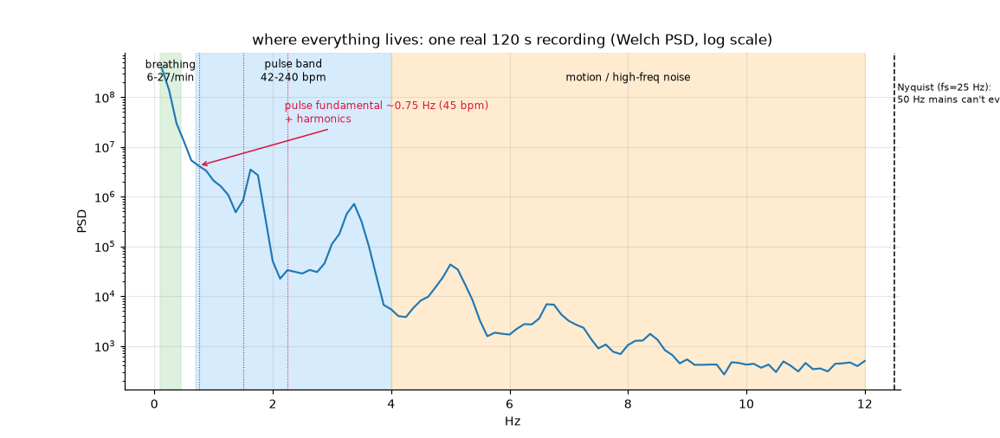
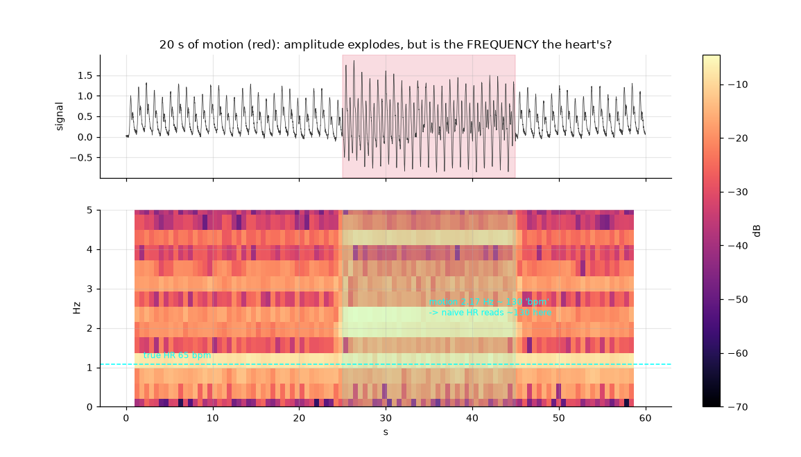

# 04 · The Frequency-Domain View of PPG

**Goal:** see where pulse, breathing and motion live in the spectrum — the map that explains
every filtering choice and every artifact failure later.

## 4.1 The address map

One PSD of 120 s of your real data tells the whole geography:

| Band | Source | Notes |
|---|---|---|
| < 0.05 Hz | thermoregulation, very slow drift | "VLF" of the HRV world |
| 0.04-0.15 Hz | HRV **LF band** (mixed sympathetic/parasympathetic + baroreflex) | appears in NN spectra, not raw PPG |
| **0.1-0.45 Hz** | **breathing** (as baseline / amplitude / frequency modulation of the pulse!) | tut 11 |
| **0.7-4 Hz** | **pulse fundamental** (42-240 bpm) + harmonics out to ~10 Hz | the AC component |
| 0.5-20 Hz | **motion** (steps 1.5-2.5 Hz, cycling, gestures) | overlaps the pulse band — *this is the core problem of wearable PPG* |
| line noise | 50/60 Hz + harmonics | **cannot exist at fs=25 Hz** (Nyquist 12.5) — and if it did, it would alias down onto the pulse band. Your notebook's 1000/period fs handling matters more than you think |

Key reading skill: the pulse is **not one line** — a pulse train has harmonics (2f₀, 3f₀…), and
respiration modulates the whole complex (sidebands). Quality metrics (tut 06) exploit exactly
this harmonic structure.

## 4.2 Estimating the spectrum

- **Welch** (`ps.welch`): average modified periodograms; window trade-off — 8 s segments give
  0.125 Hz resolution = enough to separate breathing from a 45-bpm pulse, not enough to separate
  two close heart rates. Say the window length whenever you publish a PSD.
- **Spectrogram** — Welch slid in time. This is the single most diagnostic PPG plot:

Before the motion burst: a stable ridge at 65/60 Hz with faint harmonics and a breathing ridge
near 0.25 Hz. During motion: a monster ridge at 2.17 Hz *inside the pulse band*. Any method that
picks the strongest peak now reports ~130 "bpm". No filter can separate two ridge systems that
overlap in **both** frequency and time — hence the tricks of tut 15.

## 4.3 Resolution rules of thumb

| Want | Need |
|---|---|
| breathing vs low HR separation | ≥ 16 s window (Δf ≤ 0.06 Hz) |
| HR ±1 bpm at 60 bpm | ≥ 8 s |
| HRV LF/HF bands | ≥ 2 min of NN (tut 10) |
| motion vs pulse in one second | nothing — impossible in principle |

## Pitfalls

| Pitfall | Reality |
|---|---|
| Peak of the raw spectrum = HR | The **breathing or motion** peak is often bigger; restrict to the pulse band **and** check harmonics (that's `sqi_snr`, tut 06) |
| Comparing PSD heights between recordings | Amplitude isn't calibrated (tut 01); compare *shape/ratios within* a recording |
| Zero-padding mistaken for resolution | It interpolates the plot, it doesn't add information |
| Log axis autoscale hides band overlap | Fix ylim like the figure when arguing "which ridge wins" |

➡ Next: [05_filtering_cleaning.md](05_filtering_cleaning.md).