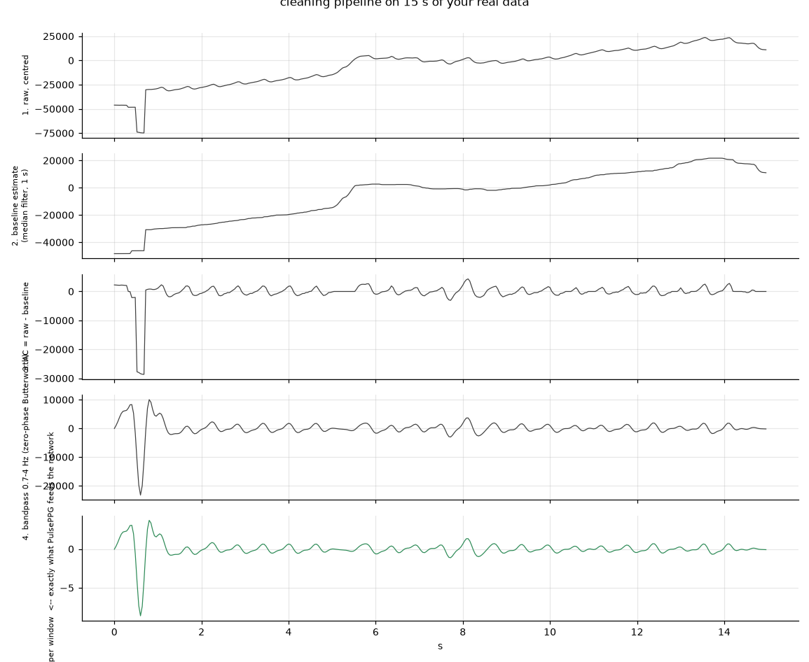
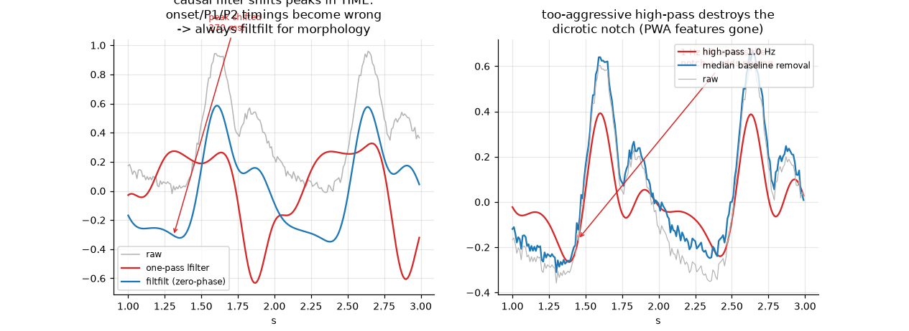

# 05 · Filtering & Cleaning Done Right

**Goal:** a cleaning chain you can copy anywhere, and the two ways naive filtering silently
destroys your features.

## 5.1 The standard chain (your data, 15 s)



1. **Remove non-physiological samples** first (tut 03: dropouts → NaN → bridge ≤1 s).
2. **Baseline (DC) removal.** Two families:
   - *median filter* (1 s window ≈ 2× longest cardiac cycle at rest) → subtract;
   - *high-pass* < 0.5 Hz.
   Median wins for PPG: it kills drift without touching the pulse (a 1 s median is transparent
   to a 0.3 s pulse).
3. **Bandpass 0.7-4 Hz** (4th-order Butterworth) for HR/quality work; widen to 0.5-8 Hz if you
   care about morphology (tut 12).
4. **Per-window z-score.** This is literally `pulseppg_embed/_preprocess.py`: resample → 30 s
   windows → z-score → network. Any deviation from this at inference time silently shifts
   embeddings.

## 5.2 Sin #1: one-pass (causal) filtering shifts time



A Butterworth `lfilter` delays different frequencies differently (non-linear phase): the systolic
peak moves tens of ms — fine for "is there a peak here", **fatal** for onset→P1→P2 timings, PTT,
or beat-to-beat comparisons. `scipy.signal.filtfilt` runs the filter forward+backward:
net phase = 0, cost = double the effective order (sharper edges, more edge ringing — pad your
signal or discard 1 s at each end). **Rule: any feature with a time axis → zero-phase.**

## 5.3 Sin #2: too-aggressive high-pass carves up the beat

A 1 Hz high-pass is "inside" the pulse's own spectral content: the dicrotic notch and diastolic
decay are *slow* features, and a sharp filter smears them and adds ringing that fake-wiggles the
diastole (visible in the right panel: compare red vs green after ~0.4 s). Since PWA indices
(tut 12) live exactly there, morphology pipelines keep the low frequencies (0.5 Hz) and remove
the baseline with the median/WLS trick instead.

**Smoothness-prior detrending** (optional upgrade): solve
`min_z ‖x−z‖² + λ‖Δ²z‖²` (Whittaker/AsLS) — λ sets the cutoff (λ ≈ 10⁶·fs ≈ 0.5 Hz-ish at
25 Hz), never rings, and keeps one-sided pulses honest.

## 5.4 Copy-paste chain

```python
import ppg_synth as ps
x2 = pd.Series(x).interpolate("linear", limit=fs)          # bridge short holes
ac = ps.detrend(x2, fs)                                    # median baseline removal
clean = ps.bandpass(ac, fs)                                # zero-phase 0.7-4 Hz
feat_in = ps.zscore(clean)                                 # what the model wants
```

## Pitfalls

| Pitfall | Fix |
|---|---|
| Filtering across a 10 s dropout | Split segments, filter each separately (or filter after masking) |
| Designing filters at one fs, running at another | Normalise by Nyquist always; assert fs |
| Edge ringing counted as beats | Discard ~1 s at segment edges after `filtfilt` |
| z-score over the whole file then window | z-score **per window** (train/inference semantics of the encoder) |
| "Filtering fixed the motion" | It attenuates out-of-band motion only; in-band motion needs tut 15 |

➡ Next: [06_signal_quality.md](06_signal_quality.md) — decide *which windows* to filter at all.