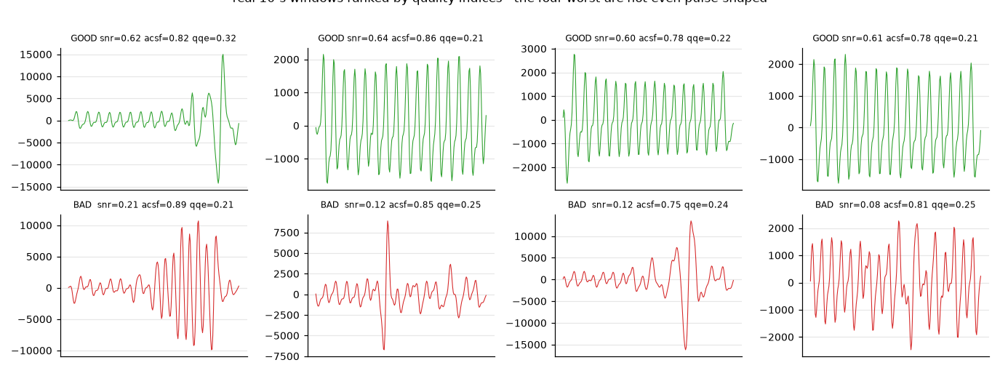
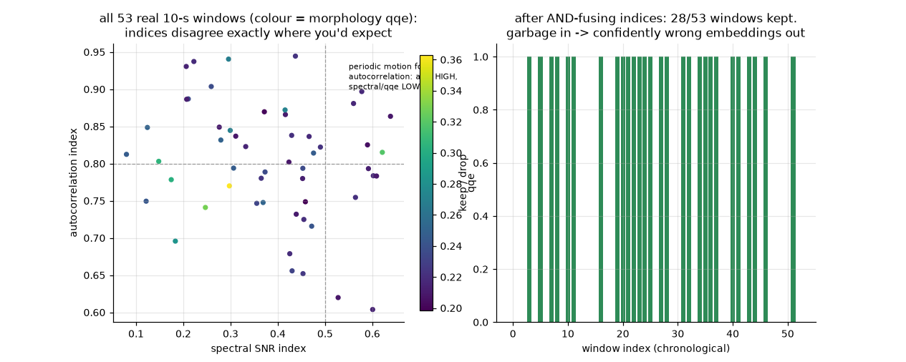

# 06 · Signal Quality: Is This Window Garbage?

**Goal:** score every window 0-1 with cheap, complementary indices and mask the rest — the single
highest-leverage step in any PPG pipeline, learned or not.

## 6.1 Why: garbage in, confidently wrong out

Neural nets never say "no signal": a bad 30-s chunk still gets a 512-d embedding, sitting calmly
next to good ones (your meal notebook's PCA would happily plot them). Quality control has to be
**explicit**, before features, before embeddings.

## 6.2 Three cheap indices (all in `ppg_synth.py`)

| Index | Idea | Code | Blinds spots |
|---|---|---|---|
| **Spectral SNR (SQI)** | pulse fundamental + harmonics should own the power: `(P(f₀)+P(2f₀)+P(3f₀))/P_total` | `sqi_snr` | quiet-but-non-pulse rhythms can have harmonics |
| **Autocorrelation (ACSF)** | a pulse train is strongly periodic: max normalised ACF in 42-240 bpm lags | `sqi_acsf` | **periodic motion is also periodic!** |
| **QQE** | real wrist beats share a shape → beat skewness≈1.7, kurtosis≈5.1 | `qqe` | needs ≥ ~8 detected beats |

They fail *differently*, which is the whole point — e.g. walking fools ACSF completely but not
the spectral/QQE pair.

## 6.3 Your data, ranked



Ten-second windows from your longest recording, best 4 and worst 4 by index: the good ones are
textbook pulse trains; the worst are noise that no detector could honestly follow.



Left: all windows, spectral-SNR vs autocorrelation, colour = QQE. The top-left "acsf high but
snr/qqe low" region is where periodic arm motion lives. Right: an **AND-fuse** rule
(`snr>0.4 and qqe>0.15`) over the recording — here only a minority of windows survive, which is
normal and *good*: those survivors are the only HR/HRV/embedding numbers you can defend.

Thresholds are dataset-specific: calibrate by plotting histograms + eyeballing 20 windows per
bin like the left panel above, on *your* data (public-data thresholds transfer poorly).

## 6.4 Where QC belongs in the pipeline

```
raw → dropout mask (tut 03) → detrend/bandpass (tut 05)
    → per-window scores → keep ≥ threshold
        → classical features (tut 16)   [only on kept windows]
        → embeddings (tut 17)           [only on kept windows]
        → report kept-fraction per file/subject   [ALWAYS]
```

If a condition ends up with systematically worse kept-fraction (e.g. "after-meal" = more arm
movement), any downstream difference may be QC bias, not physiology — include kept-fraction as a
covariate or match it across conditions.

## Pitfalls

| Pitfall | Reality |
|---|---|
| One index to rule them all | Each is blind somewhere; AND-fuse ≥2 |
| QC after embedding ("the model is robust") | Frozen encoders were not trained to flag garbage; score first |
| QC per file instead of per window | You throw away good minutes and keep junk seconds |
| Silent unequal QC between conditions | Report kept-fraction per condition (6.4) |
| Trusting HR from unmasked windows | The disagreement in tut 07 is mostly un-QC'd windows |

➡ Next: [07_heart_rate_peaks.md](07_heart_rate_peaks.md).