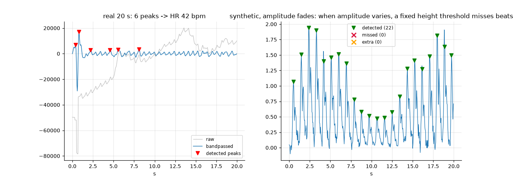
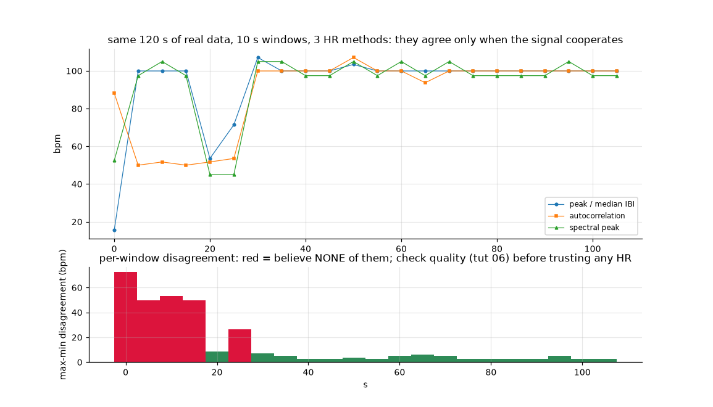

# 07 · Heart Rate: Peak Detection, Honestly

**Goal:** get a defensible HR number, and know the moment you shouldn't trust one.

## 7.1 Peak detection

Work on the bandpassed signal (tut 05), then `scipy.signal.find_peaks` with *physiology priors*:

```python
pk, _ = sg.find_peaks(band, distance=int(0.4*fs),     # max HR 150
                      height=0.15*np.percentile(band,99), prominence=...)
hr = 60/np.median(np.diff(pk)/fs)
```

Three knobs, three failure modes: `distance` too small → systolic peak *and* P2 counted (HR ×2);
`height` too high → beats lost whenever amplitude fades; both too loose → noise spikes counted.



Left: clean 20 s of your data — detection is easy, HR ≈ 100 bpm (you were moving/walking in the
after-meal files!). Right: synthetic with a slow amplitude fade — a fixed threshold misses whole
clusters of beats. Fix: adaptive threshold (running percentile), or switch method.

## 7.2 Three methods must agree — or you say "no HR"



- **Fiducial**: peaks → median IBI (above). Robust, gives beats for HRV too.
- **Autocorrelation**: max normalised ACF at pulse lags (`hr_autocorr`) — no peaks needed, great
  on noisy-but-periodic data. Bandpass *first* — residual drift makes the ACF monotone (this was
  an actual bug found while building this tutorial's figures; wrong preprocessing shows up
  instantly when methods disagree).
- **Spectral**: Welch peak in 0.7-4 Hz (`hr_fft`) — beware sub-harmonics (picking ½·HR when the
  half-rate is stronger) and picking a 0.75 Hz motion wobble.

The figure is your own 120 s: the three methods track each other in the green windows and diverge
by >15 bpm in the red ones. **Production rule:** compute ≥2 methods + a quality score (tut 06);
output `HR` only when `|method₁ − method₂| < ε`, else `NaN`. A NaN you can act on beats a
confident wrong number in a dataset you'll analyse for months.

## 7.3 Reporting HR honestly

- Report **median IBI** HR, not mean — one missed beat inflates mean-based estimates asymmetrically.
- Window length: 5-10 s for monitoring, but HRV-quality HR needs the full window (tut 09).
- Validate once per pipeline against a manual count on 5-10 min of *your* recording (mark peaks
  yourself, compute MAE). "It's scipy" is not validation. The trap: overall MAE hides a
  systematic ÷2 or ×2 on a few files — inspect per-file, not pooled.

## Pitfalls

| Pitfall | Reality |
|---|---|
| Double-detection (P1+P2 both detected) | `distance ≥ 0.35·fs` kills most of it; check IBI histogram for bimodality at ~½ median |
| HR locked to walking cadence | In-band motion (tut 15); no peak method escapes it |
| "HR = 220 bpm" in a plot | That's double-detection or 50 Hz aliasing; clamp + flag, don't plot |
| Interpolated gaps counted as RR | Exclude intervals spanning a bridge from HRV (tut 03) |

➡ Next: [08_beat_segmentation_template.md](08_beat_segmentation_template.md).