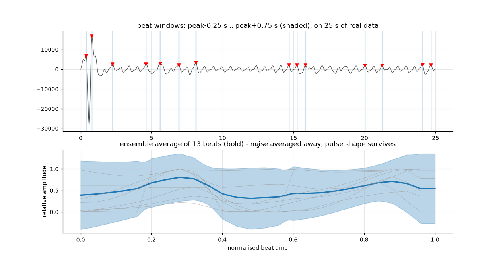
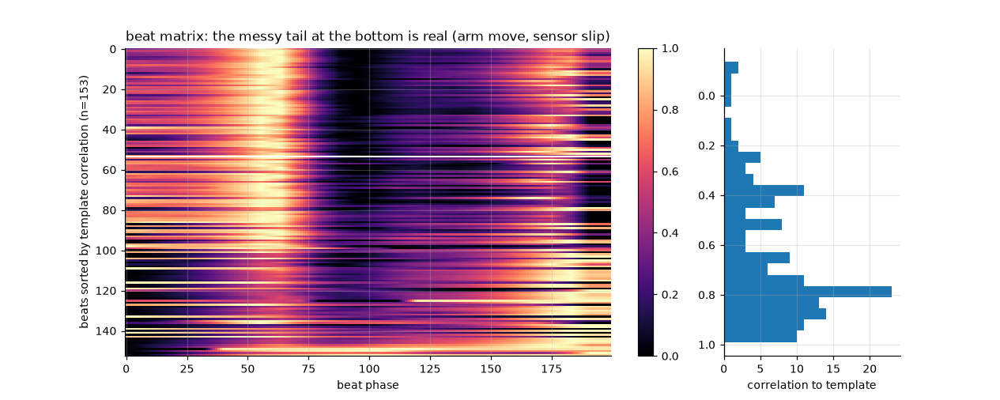

# 08 · Beat Segmentation & the Pulse Template

**Goal:** turn a raw stream into an ordered array of comparable beats — the input to
morphology (tut 12), per-beat QC (tut 06), and most classical ML on PPG.

## 8.1 From peaks to beats

Around each systolic peak take `[peak − 0.25 s, peak + 0.75 s]` (window scales with HR:
`pre=0.3·IBI, post=0.7·IBI` for fast rates), then **resample every beat to a fixed grid**
(e.g. 200 points) so beats at 50 and 120 bpm become the same shape vector:



```python
m, peaks = ps.beat_matrix(x, fs, nsamp=200)   # (n_beats, 200), min-max normalised
template  = m.mean(0)
```

The ensemble average is where wrist PPG stops being noise: uncorrelated noise cancels ~1/√n,
physiology (which repeats every beat) survives. Your 25 s excerpt already keeps a visible notch.

## 8.2 Beat-level quality: the matrix tells all



Correlate each beat with the template, sort, display as an image: a healthy file shows a bright
coherent block with a ragged minority tail (arm shifts, ectopics, dropouts). That tail is not
annoyance — it's **data**:

- `corr(beat, template) < 0.8` → exclude from morphology, flag for ectopy analysis
- sudden *slow drift* of the whole matrix → sensor sliding, re-baseline
- a few beats scattered dark → premature beats (they feed HRV cleaning, tut 09)

## 8.3 What the beat matrix buys you

| Use | How |
|---|---|
| Morphology features (tut 12) | compute on ensemble or on template-correlated beats only |
| Per-beat amplitude trend | `beat.max()` series → vasomotor/meal studies (tut 18) |
| Ectopy burden | fraction of low-corr beats per minute |
| Respiration (AM route, tut 11) | beat *amplitude* modulation = respiratory signal |
| Embedding sanity check | feed one beat, or the template, or the raw window — embeddings differ; know what yours encodes (tut 17) |

## Pitfalls

| Pitfall | Reality |
|---|---|
| Fixed window length across HR changes | Beats get truncated/dilated; scale window with median IBI |
| Resampling beats without knowing it | Interpolation to a fixed grid already changes sample rates — do PWA timing math in the *beat's own* time unit (% of cycle or ms via known IBI) |
| Averaging beats across a big motion burst | Corrupt beats bias the template; average only template-correlated ones |
| Ignoring amplitude when normalising shape | Shape ≠ size: min-max norm hides perfusion changes — keep raw amplitude as a separate feature |

➡ Next: [09_hrv_time_domain.md](09_hrv_time_domain.md) — the same peaks, but now their *timing
variation* is the signal.