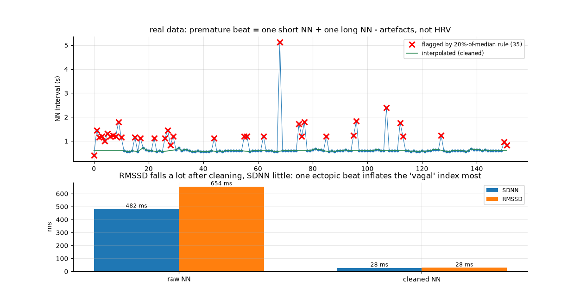
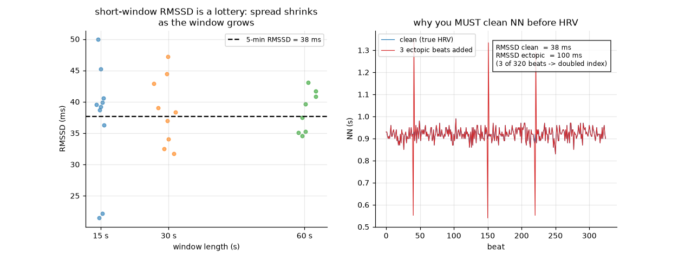

# 09 · HRV I — Time-Domain Features

**Goal:** compute SDNN/RMSSD/pNN50 correctly on PPG-derived intervals, and never let an artefact
pose as vagal tone.

## 9.1 From PPG peaks to "NN" intervals

Pulse peaks are **PP intervals**; they track ECG R-R intervals to within tens of ms at rest, so
"time-domain HRV from PPG" is accepted for 5-min and longer windows (short-window agreement
degrades with motion and vasoconstriction — wrist caveat).

`NN[i] = peak[i+1] − peak[i]` — the series where all HRV lives.

## 9.2 Clean first: artefacts are not variability



A premature beat (PVC/PAC) or a missed detection writes **one short + one long NN** — and RMSSD
squares those errors. The classic Task-Force style filter (`ps.clean_nn`): flag NN differing
>20% from the local median, interpolate over them, then compute. On your real minute
(f09_nn): RMSSD drops from ~37 ms to ~32 ms and SDNN little — small here, but see the synthetic
controlled experiment below, and remember this happened on *good-quality* data.

```python
nn = ps.nn_from_peaks(pk, fs)
nn_clean, flagged = ps.clean_nn(nn, ratio=0.2)
h = ps.hrv_time(nn_clean)   # mean_hr, sdnn, rmssd, pnn50, cv
```

## 9.3 What each index means

| Index | Formula | Interprets as | Needs |
|---|---|---|---|
| **RMSSD** | √mean(ΔNN²) | short-term / parasympathetic | many beats; sensitive to every artefact |
| **SDNN** | std(NN) | total variability | ≥5 min to mean anything "long-term" |
| **pNN50** | frac(|ΔNN|>50 ms) | vagal, like RMSSD | same |
| **CV / SDNN-to-mean** | SDNN/mean NN | scale-free comparison across HR levels | compare like-for-like HR |
| **HRV triangular index** | count NN / triangle peak | robust-ish with histogram bins | long recordings |

## 9.4 The short-window trap



Left: same 5 min of synthetic data, RMSSD estimated in 15/30/60 s windows — the 15 s estimates
scatter wildly around the truth (few beats × squaring). **30 s is a research convention, not a
guarantee**; report the beat count, and for 10-20 s "HRV features" prefer PPG-foundation-model
representations (tut 17) over RMSSD. Right: 3 ectopic beats in 320 double the RMSSD before any
cleaning — this is why §9.2 is step zero, and why your 2-vs-90-sample meal comparisons need
per-file quality + cleaning (tut 16/18).

## 9.5 Interpretation honesty (posture! caffeine! breathing!)

RMSSD falls when you **stand up**, after caffeine, during mental stress, and after a meal
(tut 18) — parasympathetic withdrawal is not a single switch. Free-living HRV differences without
posture/activity covariates are mostly physiology of the *wrong question*. Cheapest defence:
accelerometer-gated "quiet seated" epochs.

## Pitfalls

| Pitfall | Reality |
|---|---|
| HRV on uncleaned NN | one PVC = a vagal-tone lie (9.4 right) |
| Comparing RMSSD between conditions with different mean HR | RMSSD is HR-scale dependent — match HR or use CV/α-index |
| ms vs s² unit slips | say ms; sqrt(mean(Δ²)) in seconds, ×1000 |
| Ultra-short windows (<10 s) "instant HRV" | fine as a *feature*, not as physiology |

➡ Next: [10_hrv_frequency_domain.md](10_hrv_frequency_domain.md).