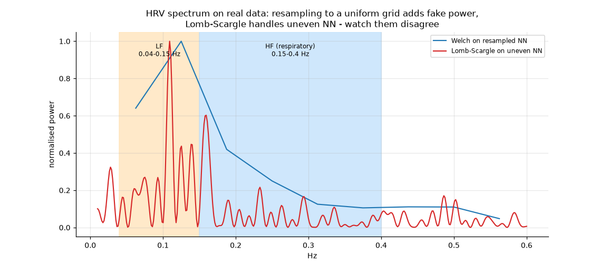
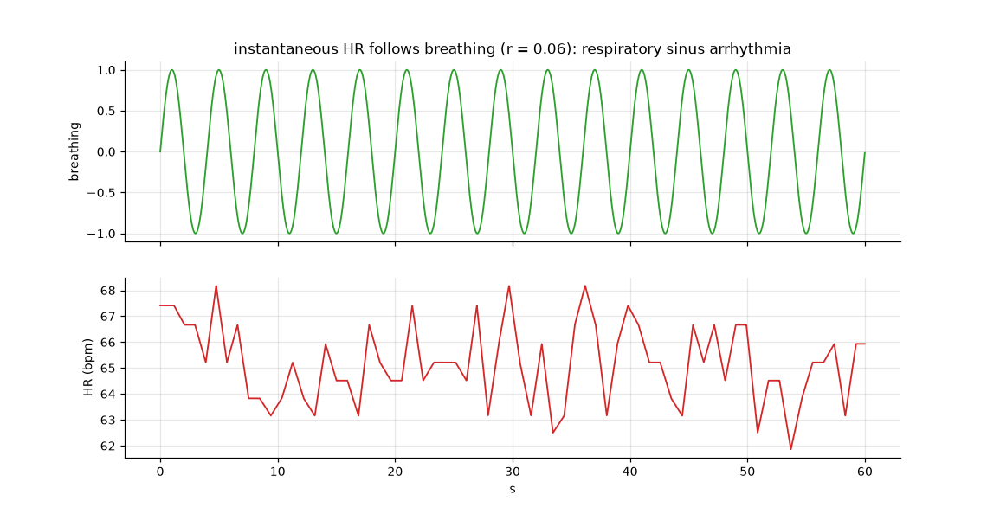

# 10 · HRV II — Frequency Domain & Breathing Coupling

**Goal:** LF/HF without the folklore, on unevenly sampled NN — and the RSA link that makes
breathing visible in heart rate.

## 10.1 The bands (of the NN spectrum, not the PPG spectrum!)

| Band | Hz | Classical label | Honest label |
|---|---|---|---|
| VLF | 0.003-0.04 | thermoregulation, slow | garbage zone for short windows |
| **LF** | 0.04-0.15 | "sympathetic (baroreflex)" | **mixed** sympathetic+parasympathetic; dominated by respiration if breathing rate falls in-band |
| **HF** | 0.15-0.4 | parasympathetic | good proxy for vagal **when breathing is ~0.2-0.35 Hz** |
| LF/HF | — | "sympatho-vagal balance" | contested; Task Force 2024 stance: interpret cautiously, mostly abandon "balance" framing |

## 10.2 Estimating it honestly: Lomb beats resampling

NN events are **unevenly sampled** — the naive pipeline is "resample NN to 4 Hz, Welch it".
Resampling is itself a (bad) low-pass: it smears power between bands. **Lomb-Scargle**
(`scipy.signal.lombscargle`) evaluates the periodogram at the actual event times:



Your real minute, both ways: the curves disagree most where it matters (LF/HF edge). Rules:
≥ 2 min of NN for band powers; ≥ 5 min for anything you'd publish; report estimator + window.

```python
fr = np.linspace(0.01, 0.6, 400)
P = sg.lombscargle(t_nn, nn - nn.mean(), 2*np.pi*fr, normalize=True)
lf = P[(fr>=0.04)&(fr<0.15)].sum(); hf = P[(fr>=0.15)&(fr<=0.4)].sum()
```

## 10.3 RSA: the mechanism behind the HF band



Breathing mechanically and reflexively modulates HR: inhale → HR up, exhale → HR down
(respiratory sinus arrhythmia). Synthetic demo: instantaneous HR tracks the 0.25 Hz "breath" with
r ≈ 0.9 — that correlation **is** the HF peak of §10.2. Two practical consequences:

1. **Controlled-breathing HRV** (pacing at 0.2 Hz) standardises the confounder across sessions —
   the trick that would strengthen any meal-PPG protocol (tut 18).
2. Slow deep breathing (~0.1 Hz) **moves respiration power into the LF band** — "LF increased,
   sympathetic activation" may just mean "subject relaxed and breathed slower".

## 10.4 Minimal honest protocol

```
clean NN (tut 09) → Lomb-Scargle → normalised units (LF/(total−VLF))
                  → report: window length, estimator, breathing rate if known
```

## Pitfalls

| Pitfall | Reality |
|---|---|
| LF/HF on 5-min free-living data as "stress" | posture+activity dominate; use as within-person trend only |
| Welch on resampled NN without saying | resampling leakage at band edges (fig) — state estimator |
| Absolute vs normalised units mixed | powers scale with total variability; never compare raw LF across people |
| Forgetting HF *is* breathing (10.3) | breathing-rate change explains most "HF changes" in relaxed conditions |

➡ Next: [11_respiratory_rate.md](11_respiratory_rate.md) — where the same coupling becomes a
measurement.