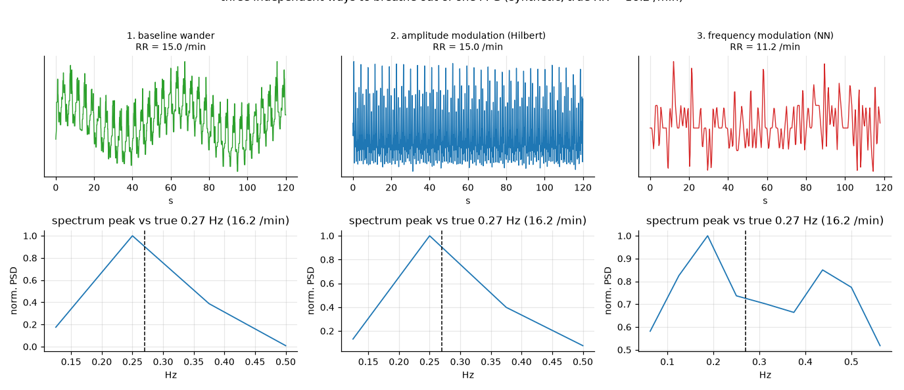

# 11 · Respiratory Rate from PPG Alone

**Goal:** extract breathing from the pulse signal via three independent routes and know their
accuracy envelope.

## 11.1 Why breathing hides in PPG

Tut 10's mechanism works on the waveform too. Each breath modulates the pulse train in three
ways (all in the 0.1-0.45 Hz band):

| Route | Mechanism | Where it lives |
|---|---|---|
| **Baseline (BLSA)** | chest volume changes optical path length | slow baseline (what tut 05 *removed*) |
| **AM** (amplitude modulation) | intrathoracic pressure ↦ stroke volume ↦ pulse size | beat-to-beat amplitude |
| **FM** (frequency modulation) | RSA! | NN-interval series |

## 11.2 Three estimators, one truth



Synthetic minute, true RR = 16.2/min: (1) median-filter baseline → PSD peak; (2) Hilbert envelope
of the bandpassed pulse, detrended → PSD; (3) NN series resampled to 4 Hz → PSD. All three land
on 16.2. Implementations: `ps.rr_baseline / ps.rr_am / ps.rr_fm`.

```python
rr1, base = ps.rr_baseline(x, fs)   # the one you already filtered away
rr2, env  = ps.rr_am(x, fs)         # |hilbert(bandpass(x))|
rr3, nn_i = ps.rr_fm(x, fs)         # RSA route, needs >= ~8 beats
```

In practice: **combine** (average the three log-PSDs before peak-picking — "comb-filter" style),
and report the number only when the top peak is prominent (>~4× the median of the band).

## 11.3 Accuracy envelope (literature, honest version)

- Supine/seated, quiet, good-quality PPG: MAE ≈ 1-2 breaths/min — belt-grade.
- Talking, walking, sleeping position changes: MAE 4-6+; in free-living it's mostly a *trend*
  sensor (and apnoea screening needs careful per-window QC + amplitude integrity).
- The FM route works even when amplitude is garbage (and vice versa) — another reason the AND/OR
  fusion of routes wins.

## 11.4 Uses in your world

- Meal/HRV studies: RR is *the* covariate for HF-HRV (tut 10) and post-meal sympathetic readouts.
- Feature batteries (tut 16): RR + its variability are cheap, interpretable, and move with
  activity, stress and digestion.
- Validation freebie: a minute where pulse PSD fundamental ÷ RR ≈ 3-6 is very likely genuine
  pulse — cross-check for tut 06 QC.

## Pitfalls

| Pitfall | Reality |
|---|---|
| PSD peak anywhere in 0.1-0.45 Hz = RR | Motion lives here too; require peak prominence + QC |
| RSA absent ≠ breathing absent | RSA weakens at high HR, in heart failure, autonomic neuropathy — fall back to BLSA/AM |
| 0.25 Hz motion harmonic counted as 15/min | exactly 15 steps/min... check accelerometer if available |
| Extracting RR from unfiltered DC | drift ≠ breathing; band-limit before peak-pick |

➡ Next: [12_pulse_wave_analysis.md](12_pulse_wave_analysis.md) — back up the frequency ladder to
waveform morphology.