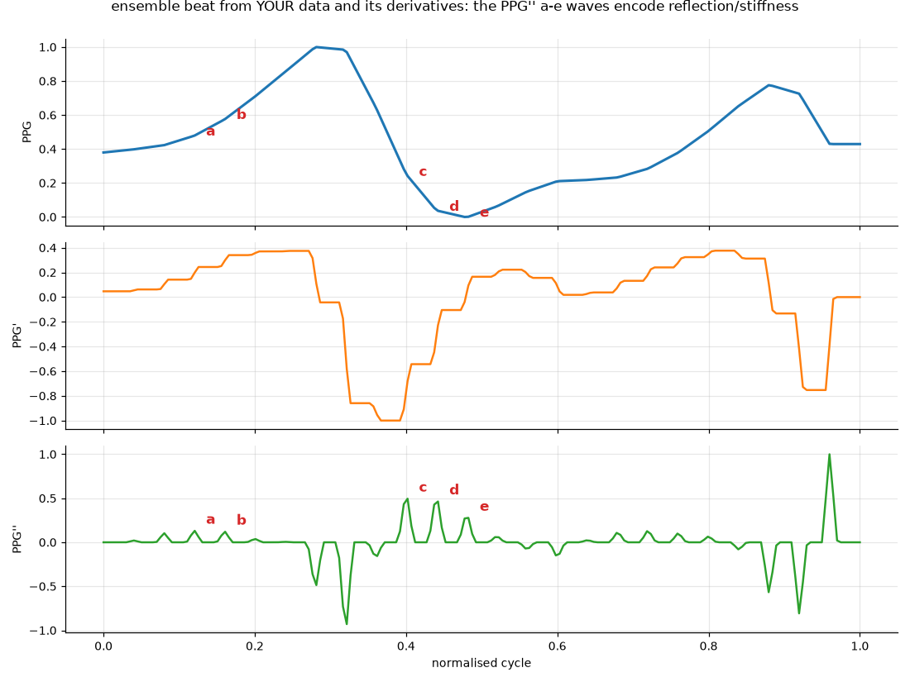
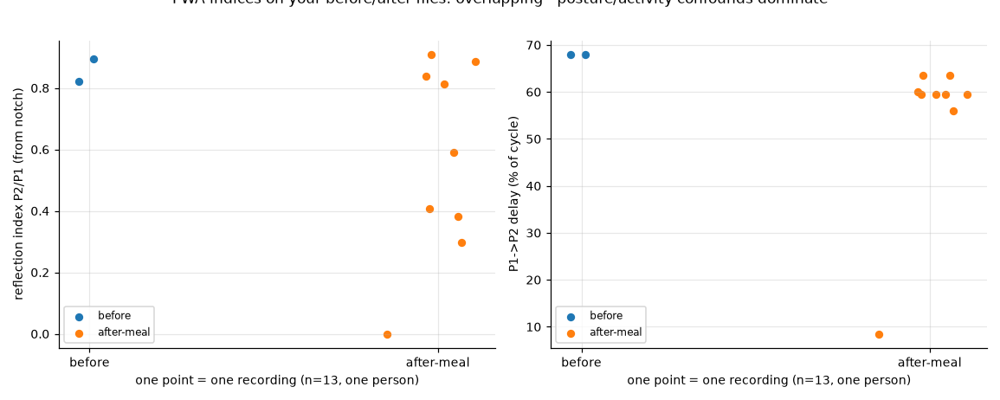

# 12 · Pulse-Wave Analysis (PWA): Your Vessels, Written in the Wave

**Goal:** turn the ensemble beat (tut 08) into vascular indices — and understand why on real
free-living files they overlap everywhere.

## 12.1 The second derivative: a-e waves



Classical wrist PWA works on **PPG″** (second derivative of the ensemble beat). Its five
characteristic points a,b,c,d,e encode the incident/reflected wave interplay:

- **a** = maximal systolic upstroke (contractility-ish),
- **b** = early diastolic decline (its position relative to the baseline is the classic
  augmentation marker; b above baseline ⇒ early reflection ⇒ stiffer vessels),
- **c** = reappearance (mitral closure-ish), **d** = late diastolic, **e** = pre-systolic.

## 12.2 The simple indices (in `ps.pwa`)

```
reflection index  RI  = (P2 − notch) / (P1 − notch)
P1→P2 delay             = t_P2 − t_P1        (↓ with stiffness)
stiffness index (fast PWA) = delay × arm height     (Hayashi, cm/s flavour)
augmentation analogue      = P2/P1                   (↑ with early reflection)
```

Compute on the ensemble or on template-correlated beats only, at normalised cycle scale; compare
*within* person/condition, never raw between people.

## 12.3 Your before/after-meal files, honestly



RI and P1→P2 delay per recording: the two conditions overlap completely. That's expected, not
disappointing: PWA sensitivity to **posture, arm height, temperature, movement** is large
(arm below heart → reflection timing shifts), and your files differ in exactly those. Published
post-meal PWA changes exist — but they come from *seated, rested, standardised-arm, 20-min
interval* protocols (tut 18's design section). This figure is the case for controlled protocols
made visible in your own data.

## 12.4 Where PWA is genuinely useful

| Application | Index family | Status |
|---|---|---|
| Arterial stiffness / vascular age research | SI, AIx, PWV (tut 13) | established with finger/cuff-calibrated devices |
| Drug/food challenge studies | augmentation index time-course | works in controlled settings |
| Volume status / anaesthesia | PWA waveform quality + amplitude | clinical niche |
| Free-living wrist nutrition inference | anything above | ⚠ confounded — see 12.3, tut 18 |

## Pitfalls

| Pitfall | Reality |
|---|---|
| Indices from single beats at 25 Hz | notch/P2 resolution ~1-2 samples; ensemble + interpolate (tut 08) or use 100+ Hz data |
| Comparing PWA across subjects | arm length/height/skin dominate; within-subject deltas only |
| Onset not located (tangent method) | P1 timing shifts with HR; the **foot** via max-slope tangent is the standard anchor |
| 1 Hz high-pass upstream (tut 05!) | you measured your filter, not the dicrotic notch |
| "Post-meal RI changed" in uncontrolled data | posture did (12.3) |

➡ Next: [13_pulse_transit_time.md](13_pulse_transit_time.md).