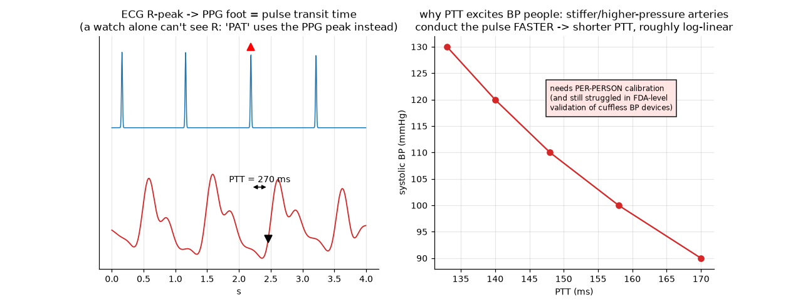
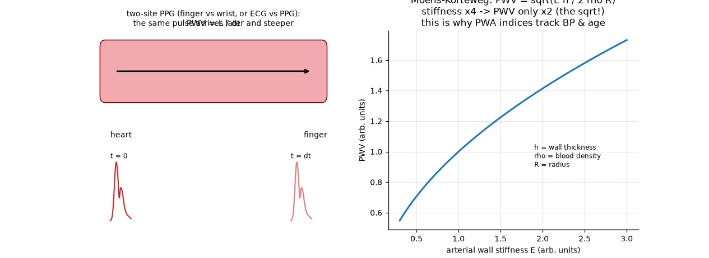

# 13 · Pulse Transit/Arrival Time, PWV — and the Blood-Pressure Dream

**Goal:** understand the PTT→BP idea, why the physics is real, and why cuffless BP devices keep
failing validation.

## 13.1 Definitions (people mix these up constantly)

| Term | Measured as | Needs |
|---|---|---|
| **PTT** pulse transit time | ECG R-peak → PPG foot | ECG **+** PPG |
| **PAT** pulse arrival time | ECG R-peak → PPG **peak** (or, watch-only: PPG onset→peak) | often no ECG |
| **PPT** pre-ejection period | R → aortic valve opening | impedance/phonocardiogram |
| **PWV** pulse wave velocity | distance / transit time between **two pulse sites** | two PPGs (e.g. finger+wrist) or imaging |

`PWV = L / Δt` — with heart→wrist path ≈ 1 m and Δt ≈ 150-200 ms → 5-7 m/s, the clinical
"gold-ish" arterial-stiffness number.

## 13.2 The timing picture

Mechanical activation follows the R-peak by the PEP, then the wave races down the artery; stiffer
or higher-pressure arteries conduct faster → **shorter PTT**. The relation to systolic BP is
roughly logarithmic within a person, which is why "BP = a·log(PTT)+b" appears everywhere.

## 13.3 The physics: Moens–Korteweg

`PWV = √(E·h / 2ρR)` — wall stiffness E, thickness h, radius R, blood density ρ. The **square
root** is why BP-PTT sensitivity is weak: pressure stiffens the wall (E rises with pressure), but
PWV only moves as √E, while PEP — which you don't measure with PPG alone — also wanders with
contractility, posture and breathing by tens of ms, comparable to the whole BP signal.

## 13.4 Why cuffless BP is hard (the honest state of the art)

1. **Inter-person**: anatomy (path length L!) kills any population calibration — L enters
   `PWV=L/Δt` directly.
2. **Intra-person drift**: PEP, temperature, hydration shift the curve within hours → devices
   need re-calibration with a real cuff.
3. Validation standards (ISO 81060-2, IEEE 1708) are strict; several high-profile cuffless
   devices have failed or never completed independent validation. Read the FDA-cleared list:
   it's short and PTT-based devices are conspicuously absent.
4. **Watch-only** (your data): without ECG you can't anchor to the cardiac cycle start; PAT
   variants carry an extra PEP nuisance term. Beat-to-beat PTT from wrist PPG onset→peak is a
   *trend* signal, not a mmHg readout.

## 13.5 What you *can* do with your setup

- Beat-to-beat PPG **onset→peak time** as a peripheral-tone proxy (QC'd windows only).
- If you ever add a phone-camera fingertip PPG alongside the watch: wrist→finger transit time
  with a fixed arm posture gives a real, publishable PWV-ish channel.
- Track PTT-like features *within* a controlled protocol (tut 18) as one of many covariates.

## Pitfalls

| Pitfall | Reality |
|---|---|
| "PTT gives us BP" in a proposal | needs per-person cuff calibration + drift management (13.4) |
| Mixing PAT and PTT in one figure | different physiology, different variance |
| Comparing PTT across sessions with different arm position | path length/height changes dominate |
| Foot detection jitter | onset tangent (tut 12) not "min of window"; jitter here *is* the BP noise |

➡ Next: [14_spo2_multiwavelength.md](14_spo2_multiwavelength.md).