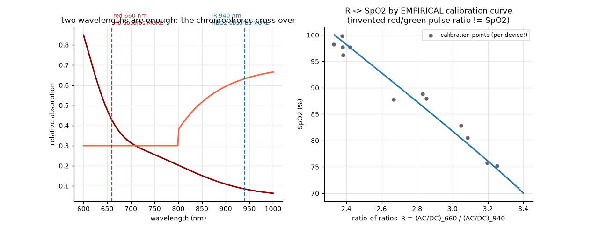

# 14 · SpO₂ and Multi-Wavelength PPG

**Goal:** understand the one PPG application with a medical-grade track record, why it needs two
wavelengths, and why green-only data can never do it.

## 14.1 Two chromophores, two windows

Oxy- and deoxy-haemoglobin absorb red and IR **differently** (the crossover is near 805 nm —
the isosbestic point where they absorb equally):



- **660 nm (red)**: deoxy-Hb absorbs much more → well-oxygenated blood lets more red through.
- **940 nm (IR)**: oxy-Hb absorbs more.
- Green sits where *both* absorb strongly and almost identically → perfect for pulse detection,
  useless for oxygenation contrast. Your wrist file cannot produce SpO₂, period.

## 14.2 The ratio-of-ratios trick (why DC cancels)

For each wavelength, Beer–Lambert gives `I = I₀·exp(−ε·c·L)` with unknown tissue path L and
stray-light I₀ — but:

- **AC** (pulse) isolates *arterial* blood only (venous/tissue is DC → cancels in AC/DC),
- taking the **ratio between wavelengths** cancels path length and geometry,
- and the ratio-of-ratios

`R = (AC/DC)_660 / (AC/DC)_940`

empirically tracks saturation. **R≈0.5 → ~100%; R≈1.0 → ~80%.** The mapping is an *empirical
calibration curve measured on healthy volunteers desaturated under ethics oversight* — not
derivable from first principles (the "curve" in the figure is schematic).

```python
# with red + IR channels:
ratio_of_ratios = ((ac_red/dc_red) / (ac_ir/dc_ir))
spo2 = interp(ratio_of_ratios, [0.4, 0.53, 0.65, 1.0], [100, 90, 80, 65])  # device-specific!
```

## 14.3 Error structure (what your finger clip actually does)

- Calibrated range 70-100%, MAE ~2%; below 70% extrapolation is guesswork.
- **Motion is SpO₂'s killer** (hospitals add multi-parameter signal-extraction quality indices —
  Masimo SET etc., exactly tut 15's ideas hardened into product).
- Perfusion, dark skin pigmentation, nail polish, venous pulsation all bias it; pulse-rate
  accuracy is easier than SpO₂ accuracy.
- Watch "SpO₂" modes: finger must be still, multi-second averaging — read their manual's
  quality caveats: they're tut 06 in marketing language.

## 14.4 What people wrongly do with green-only PPG

"Infer oxygenation from green AC/DC" — no: the AC/DC ratio in green mixes perfusion, sensor
pressure and haematocrit effects; there is **no** two-chromophore contrast to exploit. If a
paper claims green-PPG SpO₂, the burden of proof is on them (clinical validation against a CO-oximeter,
not against another pulse oximeter).

## Pitfalls

| Pitfall | Reality |
|---|---|
| SpO₂ from one wavelength | impossible in principle (14.1) |
| Using textbook R↔SpO₂ numbers on your device | the curve is device- and site-specific |
| Trusting SpO₂ during/after motion | periodic-motion artefacts pass every naive QC (tut 06/15) |
| Averaging SpO₂ over bad windows | report it *with* quality index + time-in-range, not mean |

➡ Next: [15_motion_artifact.md](15_motion_artifact.md) — the artifact that limits *everything*
above.