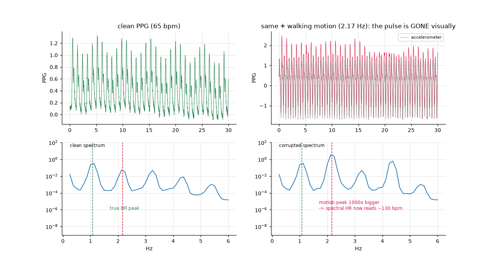
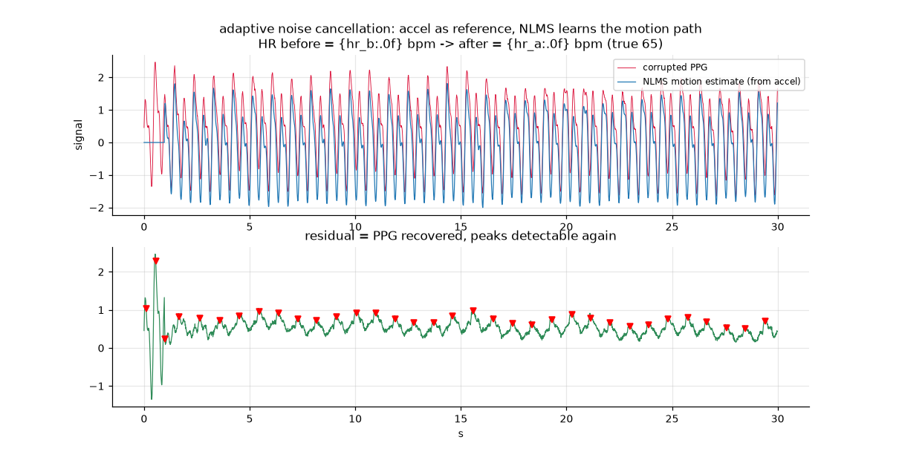

# 15 · Motion Artifact: PPG's Number-One Enemy

**Goal:** recognise the three artifact behaviours, understand the pseudo-pulse failure, and walk
the mitigation ladder from QC to adaptive filtering.

## 15.1 Why motion couples in so violently

The optical gap between LED and skin is a few mm; an arm swing shifts the sensor relative to
tissue by *millimetres* — moving the optical path, squeezing blood out of the measurement volume,
and changing venous filling. Artifact amplitudes are typically **5-20× the pulse**, and walking
cadence (1.5-2.5 Hz) lands **inside the pulse band** (tut 04).

Three behavioural types:

1. **Additive**: big oscillation, pulse still there (often recoverable).
2. **Multiplicative/cancelling**: venous emptying/pressure kills the AC entirely — *nothing to
   recover* (no filter revives a signal that stopped being measured).
3. **Pseudo-pulse (worst)**: motion at frequency f masquerades as HR = 60f — and because
   harmonics exist, detectors happily "confirm" it.

## 15.2 The failure, in pictures



20 s of walking-style motion on a 65 bpm synthetic: the time plot shows no pulse; the spectrum
shows why every naive method reports ~130 bpm. This is not hypothetical — commercial watches'
famous "HR = 128 while resting" bugs are type-3 failures; running-accuracy literature (e.g.
wrist vs chest-belt comparisons) is a literature about nothing else.

## 15.3 The mitigation ladder (always in this order)

| Rung | Tool | Recovers |
|---|---|---|
| 0 | **don't measure it** — protocol: rest windows, still arm at heart level | everything |
| 1 | **IMU as reference, adaptive filtering** (ANC) | additive periodic MA |
| 2 | **fusion**: two PPG sites/wavelengths, or PPG+ECG | site-specific artifacts |
| 3 | time-frequency/EMD/wavelet decomposition tricks | partly additive |
| 4 | ML denoisers trained on paired clean/MA data (TROIKA-style) | much, but dataset-bound |
| — | QC-mask (tut 06) | the honest baseline: drop the window |

Adaptive noise cancellation with the accelerometer as noise reference — `ps.nlms`: the filter
learns weights so `accel → (filtered) ≈ motion component of PPG`; the **residual** keeps the
pulse. NLMS update: `w ← w + µ·e·x/(xᵀx+ε)`, step µ≈0.1-0.5.



Same corrupted minute, accel reference: HR spectral peak moves back from 130 to ~67 bpm, peaks
detectable again. Conditions for ANC to work: artifact correlated with the reference (it is, for
periodic motion), pulse decorrelated from it (true unless HR≈cadence — the known blind spot;
solutions switch reference or fall back to QC-drop).

## 15.4 Practical free-living recipe (what your dataset needs)

```
kept-fraction per file (tut 06) → activity gate via accel if present
   → ANC on periodic-motion-flagged windows → re-QC after filtering
   → analysis only on post-QC windows; report each step's attrition
```

Filtering *changes* data — QC **after** ANC, never trust un-QC'd output. For your meal study the
honest options are: rest 3 min before each measurement window (protocol), or model activity as a
covariate (tut 18) — no algorithm fully rescues free-living wrist PPG contrasts.

## Pitfalls

| Pitfall | Reality |
|---|---|
| "Bandpass removed the motion" | only the out-of-band part; in-band motion survives every bandpass (15.2) |
| HR ≈ cadence after ANC | the blind spot — flag windows where accel ≈ pulse freq |
| Denoised looks smooth → must be good | ANC output *always* looks cleaner; re-run spectral QC numbers |
| Comparing conditions with different motion levels | after-meal arm movement ≠ before-meal: artifact asymmetry = fake physiology (tut 18) |

➡ Next: [16_feature_engineering_ml.md](16_feature_engineering_ml.md) — now build ML on ground that
is real.