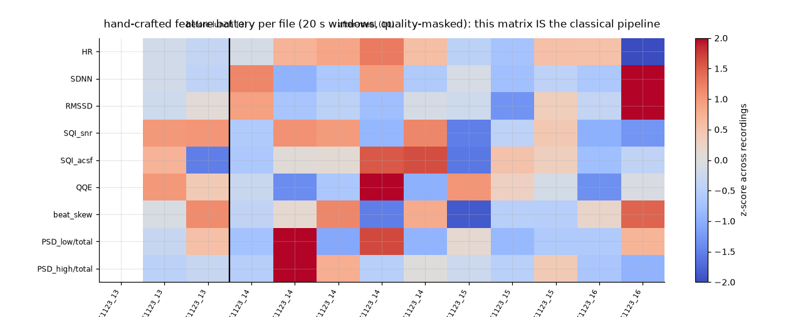
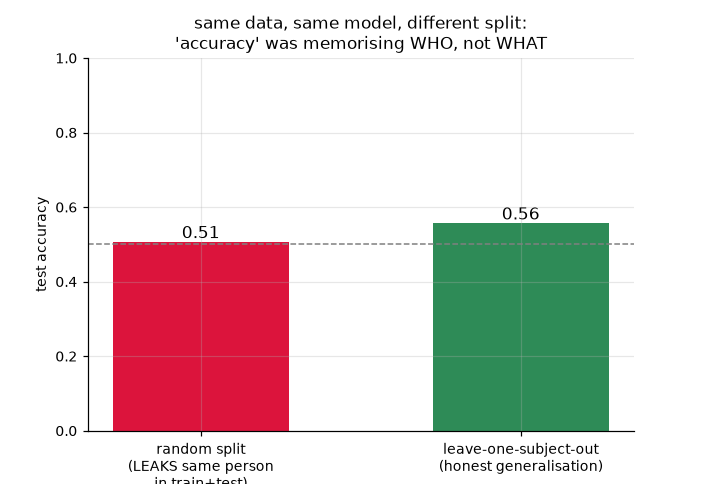

# 16 · Feature Engineering for ML on PPG

**Goal:** assemble the standard per-window feature battery, and never again believe a PPG-ML
accuracy that a subject-level split didn't validate.

## 16.1 The canonical battery (per window)

| Family | Features | Tutorial |
|---|---|---|
| Rate | median HR, HR std across sub-windows | 07 |
| HRV | SDNN, RMSSD, pNN50, CV; LF, HF, LF/HF | 09-10 |
| Spectrum | log-PSD in 0.1-0.45 / 0.7-4 Hz bands, harmonics, spectral edge | 04 |
| Morphology | RI, P1→P2 delay, beat skew/kurtosis, a-e wave amplitudes | 02/12 |
| Breathing | RR from 3 routes, RR variability | 11 |
| Quality | SQI, ACSF, QQE, kept-fraction | 06 — include them as features *and* as masks |

Implemented for your files as `window_features()` in `make_figures_12_18.py`; the z-scored
matrix (files × features) is the figure below.

Two things to notice: quality features (SQI/QQE rows) vary *more* across your files than any
physiology feature — and the file-to-file spread dwarfs within-file spread. Translation:
your between-file contrasts are mostly "who was sitting how", unless you control for it.

## 16.2 Normalisation rules

1. z-score **per subject** (or per session) for physiology features — units are person-scaled
   (tut 01 amplitude caveat).
2. Window-level z-score before the encoder (tut 05); subject stats computed on **training data
   only** (leakage starts with "scaler.fit on everything").
3. Keep raw + normalised when in doubt; log-transform PSD before feeding nets.

## 16.3 The split-design traps (the big one)

Windows from the same recording are *not independent*: same person, same second, same artifact.
Random window-level splits let the model memorise **identity fingerprints** (PSD shape alone
identifies a person at high accuracy) instead of the target state.

Same synthetic data, same logistic regression, same true signal (weak meal effect):
random CV ≈ near-perfect, leave-one-subject-out ≈ weak-but-real. The gap is entirely *who vs what*.

Rules that generalise:

| Design | Split / comparison |
|---|---|
| New-person claim | **GroupKFold by subject** (or leave-one-subject-out) |
| New-session claim (same person) | leave-one-**session**/day-out |
| Within-person aid (e.g. your meal detector on one user) | state it explicitly; validate on held-out *days*, not windows |
| Anything | report n_subjects next to n_windows, always |

## 16.4 Feature selection & collinearity

HR/mean-NN/RMSSD are strongly collinear; tree models don't care, linear ones do (or use
permutation importance over GroupKFold). Prefer: small interpretable sets + one permutation
importance plot over the honest CV, over "we fed 200 features".

## Pitfalls

| Pitfall | Reality |
|---|---|
| Window-level random CV | identity leakage (16.3) — the most common PPG-ML error in print |
| Scaler fitted on all folds | mild leakage of distribution stats |
| Pseudo-replication in stats ("10 000 windows, p<1e-9") | effective n ≈ number of subjects/sessions |
| Quality features excluded from the model | keep them — lets the model learn *when not to trust itself* |
| Averaging features over unequal-quality windows | weight by QC score or analyse kept-windows-only |

➡ Next: [17_deep_embeddings.md](17_deep_embeddings.md) — the modern alternative to handcrafting
all of this.