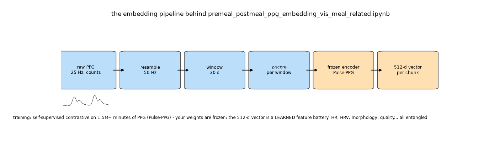
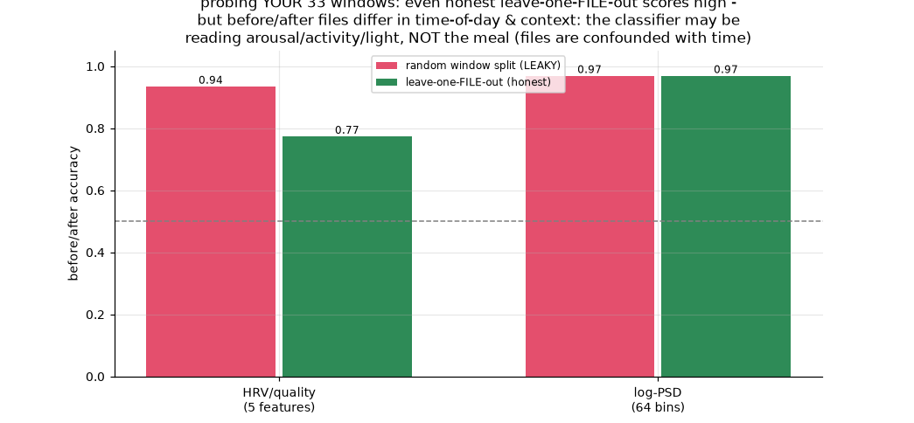

# 17 · Deep PPG Embeddings & Foundation Models

**Goal:** know exactly what the 512-d PulsePPG vectors in your notebook are, what they encode,
how to probe them honestly, and when hand-crafted features (tut 16) still win.

## 17.1 Why learned representations

Tut 16's battery is ~20 hand-picked numbers; a PPG minute carries far more (beat shape nuances,
cross-channel couplings, artifact signatures). Foundation models compress whole windows into one
vector trained to be *useful across many downstream tasks*.

Your pipeline (`pulseppg_embed/embedder.py`): resample → 30 s windows → **z-score per window**
(tut 05!) → frozen contrastive encoder → 512-d per chunk. Training was self-supervised
(Pulse-PPG style): augment a window two ways, pull the two embeddings together, push others
apart — so the vector keeps *identity of physiology*, discards nuisance (roughly: augmentation
= what you declare nuisance; resample-jitter ⇒ HR-robustness, magnitude-warp ⇒ amplitude
invariance…).

## 17.2 What mean-pooling does (your `V_file`)

Pooling 30-s chunk embeddings by mean = averaging a trajectory. It kills within-window *timing*
(meal response shape!) and is exactly the vector whose PCA projection is exact (companion
tutorial, PCA doc §1.3). Alternatives worth trying: per-chunk analysis without pooling; concat
mean+std; attention pooling — but each choice changes what "your file vector" means.

## 17.3 Probing: the only way to know what's inside

Probe = frozen embeddings + tiny classifier (kNN or linear). Two probes, two questions:

| Probe | Tests |
|---|---|
| kNN cosine, **leave-one-file/day-out** | does window-level physiology transfer across files? |
| same, **random window split** | how much is file-identity memory (tut 16 leakage)? |

On your 31 QC'd windows: PSD and HRV features separate before/after almost perfectly **even with
honest per-file splits** — yet the notebook's embedding cosine analysis found *no* structure.
Read the figure title carefully: your "before" files are all ~13:00 and "after" files ~15:20 —
time-of-day, posture, activity and light differ *systematically with the label*. High accuracy
here proves your data has label-correlated structure; it **cannot** prove a meal effect. (This
is why the *embedding* result and the *probing* result can disagree: 512-d contrastive space is
HR/amplitude-invariant by design, the PSD keeps those cues.)

The design that would settle it: interleaved pre/post blocks minutes apart, multiple days, same
time-of-day control blocks (tut 18).

## 17.4 Embeddings vs hand-crafted: reporting rules

1. Always report the **hand-crafted baseline** (tut 16 battery, same honest CV) next to the
   embedding probe — embeddings that don't beat log-PSD + HRV on 13 files tell you nothing.
2. Report what changed with quality-masking (tut 06) — embedding distances are notorious for
   encoding signal quality as "physiology".
3. Small-n rule: with ≤ dozens of files, probe with **kNN on cosine** and permutation nulls
   (companion tutorial, silhouette doc) — no fine-tuning, no deep heads.
4. Cosine vs L2 on embeddings: L2-normalise first and the debate vanishes (companion tutorial,
   similarity doc).

## Pitfalls

| Pitfall | Reality |
|---|---|
| "Foundation model understood my PPG" | it understood its pretraining distribution; QC-garbage still embeds confidently (tut 06) |
| Comparing embedding accuracy (honest CV) vs baseline accuracy (leaky CV) | the comparison itself is leaky — same CV everywhere |
| Mean-pooling then interpreting timing changes | timing is averaged away; analyse per-chunk for dynamics |
| Different preprocessing at probe time vs train time | z-score/window/fs must match `embedder.py` exactly |

➡ Next: [18_meals_glucose_ppg.md](18_meals_glucose_ppg.md) — all of it, applied to your question.