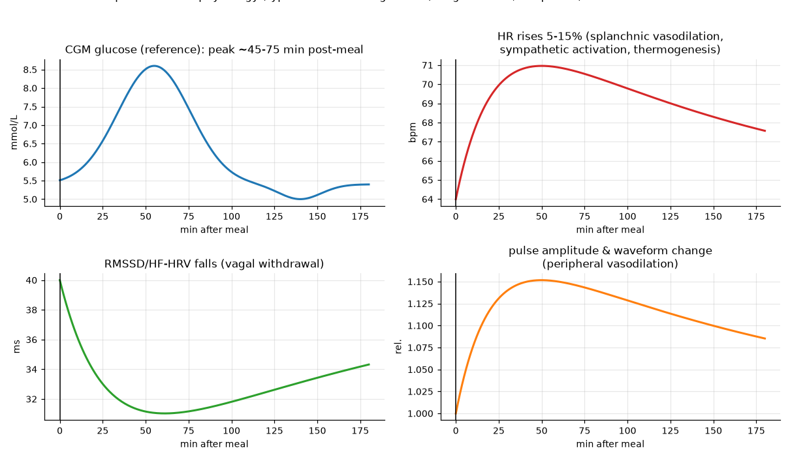
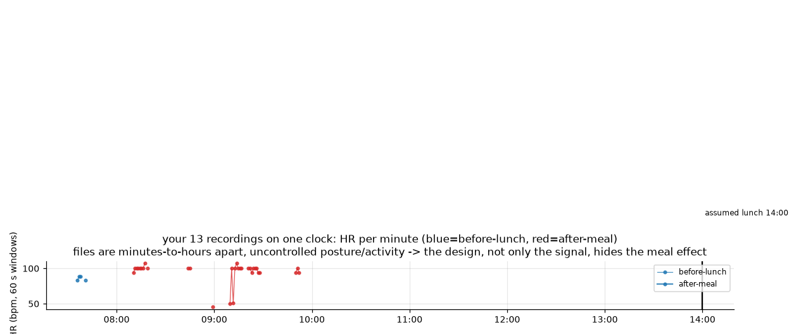

# 18 · PPG for Meals, Glucose & Metabolic State

**Goal:** what PPG *does* change after a meal, what the meal/glucose-detection literature
actually achieved, and how to design your CGM+PPG study so a real effect can be seen.

## 18.1 Real post-meal physiology you can measure optically

After a mixed meal (magnitudes typical in the literature):

| Signal | Change | Mechanism |
|---|---|---|
| HR | **+5-15%** over 30-120 min | splanchnic hyperaemia, sympathetic activation, diet-induced thermogenesis |
| RMSSD/HF-HRV | **falls** | parasympathetic withdrawal (tut 09-10) |
| PPG amplitude | rises then normalises | cutaneous vasodilation (tut 01 amplitude caveat!) |
| PWA/augmentation | shifts | early reflection from reduced systemic resistance |
| glucose (CGM, separate sensor) | peak 45-75 min | the thing you actually want to predict |

Composition matters: glucose drink > mixed meal > water; fat/protein slow and flatten; ~50 g
carbs is the typical minimum for a reliable HRV shift. Caffeine, nicotine, exercise within 2 h,
and sleep each produce HR/HRV changes **as large as the meal** — they are the enemy.

## 18.2 What detection literature achieved (honest summary)

- Continuous-from-PPG **glucose regression from wrist PPG alone**: not credibly demonstrated at
  research grade; claims exist, replications don't. CGM remains required for the target variable.
- **Meal-time detection** (binary "eating soon/happened"): works best with PPG **features +
  IMU + time priors** in the *same person*; reported sensitivities ~0.7-0.9 in lab, much lower
  free-living. Most of the win comes from circadian priors and movement, not pulse morphology.
- **Post-meal HR/HRV response**: robust in group studies (n≥20, controlled) — weak per-event,
  per-person. Meta-message: PPG sees *autonomic consequences* of meals with a 20-60 min lag and
  10-20% effect size; SNR demands within-person designs.

## 18.3 Your data through this lens

Per-minute HR across your 13 files: after-meal files sit in a higher/arousal regime, but so
would any 15:20 recordings after moving around — the confounding documented in tut 17's probing.
Your notebook's negative embedding result (within≈between cosine≈0.745) says: at 30-s chunk
resolution with mean pooling, **the embedding space finds no pre/post partition** — consistent
with "effect exists but design can't isolate it", not with "PPG is blind to meals".

## 18.4 Design that could win (concrete protocol)

1. **Within-person, counterbalanced**: 3 test meals + 1 no-meal control at the *same clock time*
   on different days (kills time-of-day confound).
2. Standardise: 10 min seated rest pre-window; same body position; no caffeine 2 h; water-only
   control arms.
3. Windows: 5-min blocks every 15 min from −30 to +150 min post meal start (matches lag).
4. Align CGM↔PPG by **per-person lag search** (cross-correlate CGM curve vs HRV-shift curve,
   0-60 min grid) — report the distribution of best lags.
5. Features: RMSSD, HF-power, per-beat amplitude trend, RR, plus **activity covariates** (IMU);
   QC-mask everything (tut 06), report kept-fraction per condition.
6. Stats: mixed-effects model per person→group, *not* window-level p-values (pseudo-replication,
   tut 16); permutation null for any accuracy claim; embeddings probed **alongside** the
   hand-crafted baseline (tut 17).
7. n: for the ~10-15% HRV effect sizes, 15-30 people × 4 days is the realistic range; at n=1,
   frame everything as single-case evidence-of-concept.

## 18.5 Why negative results are the honest default

With uncontrolled timing (your case), a *null* is expected: the meal effect (~10%) sits under
posture/activity/time-of-day variance (often >50%). Publishing "no structure found under design
X" plus the *detectable-effect estimate* is a real contribution — the figures in this tutorial
are exactly that analysis pipeline, pre-built.

## Pitfalls

| Pitfall | Reality |
|---|---|
| Comparing "before lunch" vs "after lunch" files at arbitrary times | time-of-day ≡ label (18.3) |
| Window-level significance tests | pseudo-replication (tut 16) |
| Claiming glucose from PPG features | you're modelling autonomic response, not glucose; keep CGM as ground truth |
| Ignoring meal composition/lag in pooling | blur the response; align per-person (18.4.4) |
| Dropping "failed" QC'd files silently | biases conditions; report attrition (tut 06) |

➡ Back to the [series index](README.md).